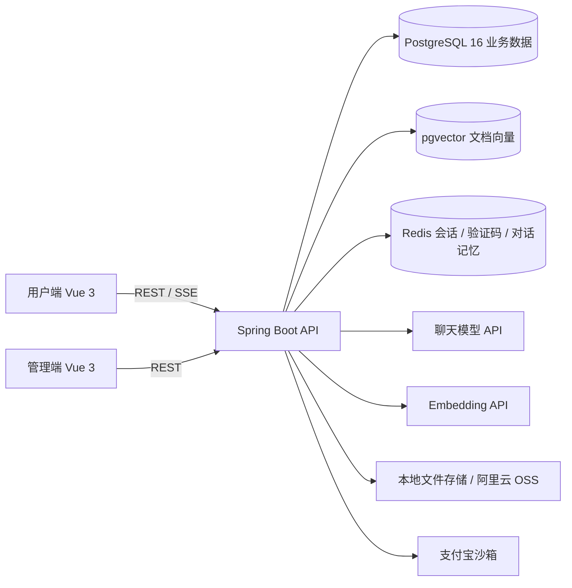

# 智能笔记 · Smart Notes

面向个人知识整理与团队资料协作的 AI 笔记项目，包含用户端、管理端、Java 后端、数据库初始化与迁移脚本、接口说明和构建检查。

项目把 Markdown 笔记、文档上传、向量检索、AI 问答和团队空间放在同一套流程中：记录内容，整理成知识库，再通过对话查找与复用资料。

[需求与功能](#需求与功能) · [技术架构](#技术架构) · [本地运行](#本地运行) · [服务配置](#服务配置) · [构建与部署](#构建与部署) · [测试与当前限制](#测试与当前限制) · [文档导航](#文档导航)

## 项目背景

学习笔记、工作文档和临时想法常散落在不同文件或聊天记录中。文件夹可以整理位置，却难以回答“哪些资料提过这个问题”“这份文档的重点是什么”“团队之前如何处理过类似情况”。

本项目围绕以下需求展开：

| 使用者 | 实际需求 | 对应能力 |
| --- | --- | --- |
| 个人用户 | 记录、分类、找回笔记，减少重复整理 | 笔记本、Markdown 编辑、自动保存、标签、搜索、置顶和回收站 |
| 知识库使用者 | 从自己的资料中获取答案 | 文档解析、分段、Embedding、向量检索及结合资料的问答 |
| 团队成员 | 共享上下文，共同维护文档，追溯修改 | 团队空间、共享知识库、成员权限、文档锁和历史版本 |
| 管理员 | 维护用户、公开内容和业务数据 | 独立管理端、账号审核、笔记、模板、评论、订单和看板 |

目标是缩短从“记录资料”到“再次使用资料”的路径。AI 回答仍需结合原文核实，知识库检索不保证每次命中完整上下文。

## 当前状态

仓库包含完整的前后端项目源码。2026-10-30 对新上传的两个前端完成了一轮核心业务联调，修复了构建、路由、笔记保存、上传和管理端发布等问题。

- 用户端、管理端和后端均已通过本地构建，前端针对性回归测试共 7 项通过。
- 已实测登录、笔记操作、广场互动、真实 OSS 上传下载、向量索引、AI 问答、模板、共享库、团队文档及管理端发布。
- 2026-11-15 完成学习闭环功能联调：Agent 可读取个人笔记、任务、复习计划和知识库；笔记可生成关联来源的任务与复习计划；复习支持每天、每周指定星期或自定义间隔，并可查看后续日期。
- 项目仍处于完善阶段；一次联调不等于全部功能已经验收。支付、物理文件回收等边界见[测试与当前限制](#测试与当前限制)。
- 仓库不附带真实账号、业务数据库、云服务密钥或运行中的服务，克隆后需要自行初始化并配置。

具体操作、修复及验证范围见[学习闭环联调报告](docs/前后端联调报告-20261115.md)及[2026-10-30 核心功能联调报告](docs/前后端联调报告-20261030.md)。

## 需求与功能

| 模块 | 用户端能力 | 管理与后端支持 |
| --- | --- | --- |
| 账号 | 图形验证码、注册、登录、资料维护 | 角色区分、管理员审核、用户管理 |
| 笔记 | 笔记本、Markdown 编辑、自动保存、标签、搜索、置顶、导出、回收站 | 持久化、归属校验、笔记管理 |
| AI 助手 | 流式对话、会话历史、续写、润色、总结、翻译 | 模型调用、会话记忆、SSE 输出 |
| 个人知识库 | 上传、处理状态、预览、下载、基于资料提问、结构化整理 | 文档解析、向量索引、检索和访问校验；RAG 回答返回原文引用、相似度和 PDF 页码 |
| 共享知识库 | 创建、加入、资料管理和问答 | 成员关系与共享检索范围管理 |
| 团队空间 | 成员邀请、协作文档、评论、批注、团队 AI 会话 | 文档锁、成员权限、版本历史 |
| 笔记广场 | 发布、浏览、点赞、收藏、评论 | 内容管理、发布和下线 |
| 模板中心 | 浏览、收藏、评论、使用模板创建笔记 | 模板发布与管理 |
| 会员与订单 | 套餐、订单、支付结果页面 | 会员数据、订单管理、支付宝沙箱接口，完整支付闭环待验证 |
| 管理看板 | — | 用户、笔记、知识库、模板、评论、订单及统计页面 |

表格描述已有实现范围，逐项测试范围以联调报告为准。

## 技术架构



pgvector 是 PostgreSQL 中的扩展，业务表与向量表使用同一个数据库连接。本项目实际使用 PostgreSQL，不需要额外启动 MySQL。

| 层次 | 主要技术 | 用途 |
| --- | --- | --- |
| 后端 | Java 17、Spring Boot 3.5.0、Maven | API、业务服务、依赖管理与打包 |
| 数据访问 | MyBatis-Plus、HikariCP、PostgreSQL 16 | 数据映射、分页、连接池与业务持久化 |
| 登录与缓存 | Sa-Token、Redis 6/7 | 登录会话、角色校验、验证码和对话记忆 |
| AI 与检索 | LangChain4j 0.36.2、OpenAI 兼容接口、pgvector | 模型调用、Embedding、检索增强生成 |
| 文件与内容 | x-file-storage、OSS SDK、Apache Tika、PDFBox、POI | 文件存储、文档解析与导出 |
| 用户端 | Vue 3、Vite 5、TypeScript、Tailwind CSS 3、Vue Router、md-editor-v3 | 笔记、知识库与 AI 交互 |
| 管理端 | Vue 3、Vite 7、TypeScript、Element Plus、Pinia、ECharts、Tailwind CSS 4 | 后台页面、状态管理与统计展示 |
| 工程检查 | GitHub Actions、Node test、tsx、vue-tsc | 前后端构建、类型检查与回归测试 |

知识库处理流程：上传文件 → 解析与文本分段 → Embedding → 写入 1024 维向量 → 根据提问检索片段 → 交给聊天模型生成回答。**文件上传成功与向量索引成功是两个阶段**，使用知识库问答前应确认处理状态成功。

### 第一优先级 AI 功能

- **资料生成结构化笔记**：个人知识库页面支持选择 PDF、PNG、JPG、JPEG、WEBP 或 BMP，后端提取 PDF 文本或调用视觉模型，返回标题、摘要、关键要点、标签、待办事项和 Markdown；用户可以编辑后保存到自己的笔记本。
- **RAG 引用溯源**：个人知识库问答会返回来源文件、原文摘录、相似度、片段序号和 PDF 页码。前端引用卡片可以打开文件预览并定位到对应页，帮助用户核对回答依据。

PDF 解析按页保留 `page` 和 `pageCount` 元数据，分段时继续传递到 `documents.metadata`。共享知识库检索也会读取这组元数据。扫描版 PDF 没有可提取文本时，需要先 OCR 或导出为图片再使用结构化整理。

### 第二优先级学习闭环功能

- **Agent 业务上下文与受控工具**：选择业务型 Agent 聊天时，后端会按当前用户的问题读取其笔记、任务和复习计划，并把真实数据作为上下文提供给模型；写入操作通过 `POST /api/agent/tools/execute` 受控执行，用户 ID 始终来自登录态，模型或请求体不能越权指定其他用户。
- **笔记生成学习安排**：打开一篇已保存的笔记，点击编辑器右上角的“学习安排”，后端调用聊天模型生成最多 5 个学习任务和 2 个复习计划，服务端校验字段、日期和笔记归属后落库；生成记录标记为 `note-ai`。
- **任务与复习计划管理**：用户端侧栏新增“任务与复习”，支持查看、手动创建、完成/恢复和删除任务；复习计划可配置每天、每周指定星期或自定义间隔，查看后续日期、关联并跳转来源笔记。任务和计划也可以通过独立 REST 接口供 Agent 或其他客户端调用。

模型返回的学习安排只作为建议，落库前仍会经过标题、优先级、日期范围和当前用户权限校验；AI 服务不可用时不会伪造成功数据。

## 仓库结构

```text
smart-notes/
├─ .github/workflows/
│  ├─ backend-ci.yml                 # Java 编译与打包
│  └─ frontend-ci.yml                # 双前端回归、类型检查与生产构建
├─ docs/
│  ├─ 接口目录.md                    # 路由、参数、权限和响应类型
│  ├─ 数据字段字典.md                # DTO、VO 和实体字段
│  ├─ 前后端联调报告-20261030.md      # 核心功能联调记录
│  └─ 前后端联调报告-20261115.md      # 学习闭环联调记录
├─ note-vue/                         # 用户端
│  ├─ src/api/                       # API 封装
│  ├─ src/components/                # 编辑器与公共组件
│  ├─ src/views/                     # 用户业务页面
│  └─ tests/                         # 自动保存回归
├─ art-design-pro/                   # 管理端
│  ├─ .env.example                   # 可提交的公开配置示例
│  ├─ src/api/                       # 管理 API
│  ├─ src/router/                    # 路由与权限
│  ├─ src/views/                     # 后台业务页面
│  └─ tests/                         # 路由权限回归
├─ initialization-note-side/         # Java 后端
│  ├─ deploy/
│  │  ├─ init-local.sql              # 34 张业务表 + documents 向量表
│  │  ├─ check-local.sql             # 隔离数据库结构验证
│  │  └─ migrations/                 # 已有数据库迁移
│  ├─ src/main/java/                 # 控制器、服务、数据访问及配置
│  ├─ src/main/resources/
│  │  └─ application-example.yml     # 后端配置示例，不含真实凭据
│  ├─ src/test/                      # 遗留后端测试，需隔离环境
│  └─ pom.xml
└─ README.md
```

本机配置、依赖、构建产物、上传文件、日志和数据库备份不属于提交内容。管理端旧设计文档仅供参考；当前建表和接口以统一后端脚本、源码及根目录 `docs/` 为准。

## 本地运行

### 1. 准备环境

| 依赖 | 推荐版本 | 说明 |
| --- | --- | --- |
| JDK | 17 | IDEA 项目与 Maven Runner 都选择 JDK 17 |
| Maven | 3.9.x | 本地验证使用 3.9.16 |
| Node.js | 22 LTS，至少 22.12 | 同时满足两个前端的构建要求 |
| pnpm | 10.18.3 | 管理端使用，用户端使用 npm |
| PostgreSQL | 16 | 服务端需要安装 pgvector 扩展文件 |
| Redis | 6 或 7 | 后端启动前应可连接 |

PostgreSQL、Redis 可使用本机服务或已有容器，Docker 是可选运行方式。原生 PostgreSQL 默认端口是 `5432`；容器映射为 `15432:5432` 时，Windows 后端应连接 `15432`。

```powershell
git clone https://github.com/Landelos1/smart-notes.git
Set-Location smart-notes
```

这是私有仓库，克隆需要仓库访问权限。以下以仓库根目录和 PowerShell 为例；其他系统按相同步骤调整命令。

### 2. 初始化 PostgreSQL

先启动 PostgreSQL 和 Redis。下列命令用于**全新数据库**，需要本机原生 PostgreSQL 客户端在 PATH 中；端口、用户名与数据库名按自己的部署调整：

```powershell
createdb -h 127.0.0.1 -p 5432 -U postgres -W smart_notes
psql -h 127.0.0.1 -p 5432 -U postgres -d smart_notes -W -v ON_ERROR_STOP=1 -f initialization-note-side/deploy/init-local.sql
```

脚本会执行 `CREATE EXTENSION IF NOT EXISTS vector` 并创建 35 张表（34 张业务表和 `documents` 向量表），需要相应建表及扩展权限。提示 `vector.control` 缺失表示 PostgreSQL 服务端尚未安装 pgvector，不能只靠 SQL 解决。

也可在 IDEA / DataGrip 中连接目标 PostgreSQL 数据库，选择 `public` schema，执行整个 [init-local.sql](initialization-note-side/deploy/init-local.sql)，包括 `BEGIN` 和 `COMMIT`。失败时在同一控制台执行 `ROLLBACK;`，处理后重试。

**已有数据库先备份**，空库脚本不能自动修复旧业务表缺失字段。账号原先按手机号全局唯一时，执行[账号角色唯一约束迁移](initialization-note-side/deploy/migrations/20261030_account_role_uniqueness.sql)。更多客户端、Docker 和检查步骤见[数据库部署说明](initialization-note-side/deploy/README.md)。

仓库不导入历史用户、私人文件或预设套餐价格。

### 3. 配置并启动后端

首次运行复制示例：

```powershell
Copy-Item initialization-note-side/src/main/resources/application-example.yml initialization-note-side/src/main/resources/application.yml
```

已有 `application.yml` 时直接修改，避免覆盖自己的设置。至少确认：

- `spring.datasource` 指向初始化后的数据库，账号密码正确，JDBC URL 显式填写端口。
- `spring.data.redis` 主机、端口、数据库编号与密码正确。
- `sa-token.jwt-secret-key` 使用自己的随机值。
- 聊天与 Embedding 模型使用自己的凭据，文件存储选择本地或自己的 OSS。
- 如果要使用图片资料结构化，额外配置 `AI_VISION_BASE_URL`、`AI_VISION_API_KEY` 和 `AI_VISION_MODEL`；视觉模型使用 OpenAI 兼容的 `/chat/completions` 接口。PDF 文本整理不依赖这三个配置。

示例 JDBC URL 可改为 `jdbc:postgresql://127.0.0.1:5432/smart_notes?sslmode=disable`。`CHANGE_ME` / `YOUR_*` 是占位符，不是可用凭据；完整说明见[服务配置](#服务配置)。

IDEA 启动步骤：

1. 打开 `initialization-note-side/pom.xml`，导入 Maven 项目并等待依赖下载完成。
2. 将 Project SDK 与 Maven Runner JDK 设为 17。
3. 运行主类 `com.ldd.initialization.InitializationApplication`。
4. 确认服务监听 `8889`，启动日志无数据库、Redis 或配置异常。

或在仓库根目录执行：

```powershell
mvn -B -f initialization-note-side/pom.xml spring-boot:run
```

后端地址为 `http://localhost:8889`。访问 `/` 返回 404 不代表启动失败；可访问 `http://localhost:8889/api/common/captcha`，应返回包含图形验证码信息的 JSON。

### 4. 启动用户端

新开终端，进入仓库的 `note-vue` 目录：

```powershell
npm ci
npm run dev
```

访问 `http://localhost:3000`。代理位于 [note-vue/vite.config.js](note-vue/vite.config.js)，默认将 `/api` 转发到 `http://localhost:8889`。修改后端端口时同步修改并重启前端。

### 5. 启动管理端

尚未安装 pnpm 时，先执行 `npm install --global pnpm@10.18.3`。再新开终端，进入仓库的 `art-design-pro` 目录：

```powershell
Copy-Item .env.example .env.local
pnpm install --frozen-lockfile
pnpm dev
```

已有 `.env.local` 时跳过复制。访问 `http://localhost:3006/#/auth/login`；`VITE_API_PROXY_URL` 默认指向 `http://127.0.0.1:8889`，`VITE_ACCESS_MODE=frontend` 使用当前项目的前端路由配置。

所有 `VITE_*` 配置都会进入浏览器代码，不能保存数据库密码、模型 API Key、OSS 密钥或支付私钥。两个前端按各自 lockfile 安装，避免混用 npm 和 pnpm。

### 6. 注册与首个管理员启用

普通用户在用户端注册，角色为 `1`；管理员在管理端注册，角色为 `2`，初始状态为待审核。同一手机号可以分别注册两种角色，每个角色内唯一。仓库不附带默认账号或密码。

已有管理员时通过管理端审核。**全新自建环境还没有管理员时**，由数据库维护者先核对刚注册的管理员身份，再在自己的数据库控制台操作；必须替换手机号，不能批量启用：

```sql
SELECT id, phone, username, role_type, status
FROM public.t_user
WHERE phone = '替换为刚注册的管理员手机号' AND role_type = 2;

UPDATE public.t_user
SET status = 1, update_time = CURRENT_TIMESTAMP
WHERE phone = '替换为刚注册的管理员手机号'
  AND role_type = 2 AND status = 2
RETURNING id, username, role_type, status;
```

确认只返回目标账号后再登录管理端。状态为 `0` 禁用、`1` 启用、`2` 待审核；普通用户无需上述操作。

### 7. 首次自检与日常启动

建议依次验证：注册登录 → 新建笔记本和笔记 → 编辑后刷新确认保存 → 上传小 TXT → 等待索引成功 → 根据 TXT 内容提问并打开引用 → 上传可复制文字的 PDF 检查页码 → 使用结构化整理生成笔记并保存到笔记本 → 检查管理端发布与下线。

日常无需重复建表、注册或安装依赖，确保 PostgreSQL、Redis、后端和所需前端已运行即可。数据库安装为系统服务并自动启动后，无需每次手动启动；依赖锁文件变化时再重新安装前端依赖。

## 服务配置

后端配置入口为 [application-example.yml](initialization-note-side/src/main/resources/application-example.yml)。复制后修改，或通过环境变量覆盖对应值；IDEA 可以在 Run Configuration 的 Environment variables 中设置。

| 服务 | 环境变量 | 说明 |
| --- | --- | --- |
| PostgreSQL | `DB_URL`、`DB_USERNAME`、`DB_PASSWORD` | 默认 `localhost:5432/postgres`，修改为自己的库和端口 |
| Redis | `REDIS_HOST`、`REDIS_PORT`、`REDIS_DATABASE`、`REDIS_PASSWORD` | 默认 `localhost:6379`、数据库 `2`，有密码时填写 |
| 登录 | `JWT_SECRET_KEY` | 使用自己的随机密钥，替换占位符 |
| 用户端地址 | `FRONTEND_URL` | 默认 `http://localhost:3000`，部署时修改 |
| 聊天 | `AI_CHAT_BASE_URL`、`AI_CHAT_API_KEY`、`AI_CHAT_MODEL` | 示例为 DeepSeek，普通与流式聊天共用这些变量 |
| Embedding | `AI_EMBEDDING_BASE_URL`、`AI_EMBEDDING_API_KEY`、`AI_EMBEDDING_MODEL` | 示例为百炼兼容接口与 `text-embedding-v3` |
| 阿里云 OSS | `OSS_DOMAIN`、`OSS_ACCESS_KEY`、`OSS_ACCESS_SECRET`、`OSS_BUCKET`、`OSS_ENDPOINT`、`OSS_BASE_PATH` | 仅后端持有凭据，还需切换实际存储平台 |
| 支付宝 | `ALIPAY_APP_ID`、`ALIPAY_PRIVATE_KEY`、`ALIPAY_PUBLIC_KEY`、`ALIPAY_GATEWAY_URL`、`ALIPAY_RETURN_URL`、`ALIPAY_NOTIFY_URL` | 示例为沙箱网关，不代表生产支付已开通 |

### 聊天与知识库模型

聊天模型生成答案，Embedding 模型把资料转换为向量，两者的接口和 Key 可能来自不同服务商。只配置聊天模型不能保证知识库索引可用。

当前 [PgVectorConfig](initialization-note-side/src/main/java/com/ldd/initialization/config/ai/PgVectorConfig.java) 与初始化脚本均使用 **1024 维**。更换 Embedding 模型或维度前，需要同步调整代码与数据库，并重新生成已有资料的向量；不同模型产生的向量不应直接混用。

示例使用 OpenAI 兼容接口，新增供应商仍需验证兼容性。模型请求与响应日志默认关闭。

### 文件存储

示例默认使用 `local-plus`，文件写入后端工作目录下的 `./data/uploads/`。相对路径取决于启动工作目录；正式运行建议使用固定持久目录并备份。

使用 OSS 时，在 `dromara.x-file-storage` 中将 `default-platform` 改为 `aliyun-oss`，将该平台 `enable-storage` 设为 `true`，填写自己的 Bucket、Endpoint、域名、路径前缀及凭据。变更后重启后端，再验证上传与下载。

### 支付

支付宝应用 ID、应用私钥和支付宝公钥保存在后端。`return-url` 是支付后的浏览器跳转地址，`notify-url` 是支付宝服务器调用的后端通知接口；验证异步通知需要公网可访问地址。

初始化脚本不预设套餐价格，支付还需要部署者配置有效套餐和自己的支付宝应用。本次联调未执行真实付款、退款和公网回调验证。

## 接口约定

- 开发时浏览器通过前端 `/api` 代理访问；直接调试后端使用 `http://localhost:8889/api/...`。
- 登录返回令牌，后续发送 `Authorization: Bearer <token>`；角色与资源归属校验由后端处理。
- 大多数 JSON 接口返回 `{ "code": 0, "message": "成功", "data": ... }`，业务成功码为 `0`。
- 分页通常为外层 `data` 中包含 `{ "data": [], "total": 0 }`，直接返回分页实体的接口以文档为准。
- HTTP 200 不一定表示业务成功，还需检查 `code`；下载和支付宝通知等接口不统一返回上述结构。
- AI 流式接口使用 SSE，应按事件解析；上传还需区分文件保存和后续索引状态。

完整路由、参数与权限见[接口目录](docs/接口目录.md)，字段见[数据字段字典](docs/数据字段字典.md)。接口目录当前整理了 181 个路由；源码变化时需要同步更新，并非每个接口都已完成端到端测试。

## 构建与部署

### 后端打包

在仓库根目录执行：

```powershell
mvn -B -f initialization-note-side/pom.xml -DskipTests package
```

产物为 `initialization-note-side/target/initialization-node-0.0.1-SNAPSHOT.jar`，可用 Java 17 启动。配置可放在仓库外，例如先自行创建 `E:/smart-notes-config/application.yml` 并填写，再执行：

```powershell
java -jar initialization-note-side/target/initialization-node-0.0.1-SNAPSHOT.jar --spring.config.location=file:E:/smart-notes-config/application.yml
```

路径为示例，项目不会自动创建该目录。Maven JAR 构建会排除 `application*.yml` / `application*.yaml` 配置文件；生产运行应通过外部配置提供凭据。IDEA 从项目资源目录启动时仍可读取本地 `application.yml`。

### 前端构建

分别在对应目录执行：

```powershell
# note-vue
npm ci
npm test
npm run build

# art-design-pro：首次构建前准备好 .env.local
pnpm install --frozen-lockfile
pnpm test
pnpm build
```

用户端产物为 `note-vue/build/`，管理端产物为 `art-design-pro/dist/`。管理端先由 Vite 生成自动导入声明，再运行 `vue-tsc --noEmit`；类型检查失败仍使整个构建失败。

### 生产部署还需完成的配置

- 静态服务器托管两个前端，配置 `/api` 反向代理；Vite 开发代理不会进入静态产物。
- 用户端使用 history 路由，页面请求需回退到 `index.html`；管理端使用 hash 路由。
- SSE 关闭代理缓冲并设置合适读取超时；上传请求大小与后端限制保持一致。
- 持久化 PostgreSQL、Redis 和本地上传目录，设置备份、恢复验证、日志轮转和进程重启。
- 使用实际域名和 HTTPS，核对支付回调、文件域名和前端地址，完成权限与安全复核后再对外开放。

仓库目前未提供完整的生产一键部署方案，开发服务启动成功不能代替生产配置验证。

## 测试与当前限制

### 检查范围

| 检查 | 内容与本地结果 |
| --- | --- |
| 后端构建 | Java 17 编译与打包通过，使用 `-DskipTests` |
| 用户端 | 类型检查、生产构建及 4 项自动保存回归通过 |
| 管理端 | 类型检查、生产构建及 3 项路由权限回归通过 |
| 数据库 | 空库初始化 35 表、pgvector、角色约束迁移与重复迁移通过 |
| 核心业务联调 | 登录、笔记、广场、OSS、索引、AI、模板、共享库、团队、管理端发布通过 |
| 学习闭环联调 | Agent 业务上下文与知识库隔离、受控工具、笔记生成任务/复习计划、任务和计划管理通过 |

2026-11-15 学习闭环变更通过后端打包、用户端 10 项自动回归和生产构建，并在本机运行的 PostgreSQL、Redis、模型 API、OSS 配置下完成真实 API 与浏览器联调。后续页面回归验证了周期字段持久化、来源笔记清除，以及带微秒截止时间任务的创建、完成和恢复。此前还核验了登录验证码、用户隔离、AI 生成与替换、知识库向量检索隔离、Agent 对话历史和移动端布局。逐项结果及测试数据清理情况见[学习闭环联调报告](docs/前后端联调报告-20261115.md)。

GitHub Actions 使用 Java 17 / Node 22；前端对应目录变化时运行锁定依赖安装、回归测试与生产构建。检查通过代表所列检查通过，不代表完整业务验收。

后端部分遗留测试依赖外部服务、固定用户和业务库，可能改写数据，因此日常 CI 不运行完整套件；需要时先准备隔离数据库、账号与配置。`deploy/check-local.sql` 也只用于隔离测试库，虽回滚业务数据，自增序列仍可能前进。

### 已知限制与待完善项

1. **文件物理回收未完善**：回收站“彻底删除”删除数据库记录，但不会自动清理 OSS / 磁盘原文件；需结合引用检查和失败重试补齐。
2. **支付闭环尚未全面验证**：真实付款、退款、支付宝公网通知与异常补偿需要专项测试。
3. **部分预览依赖较大**：Office / PDF 形成较大 chunk，可能影响首次加载；尚未覆盖全部格式和大文件。
4. **结构化整理输入范围**：当前接口只接受 PDF、PNG、JPG、JPEG、WEBP、BMP，单文件最大 20 MB；扫描版 PDF 需要先 OCR 或转图片，图片整理需要单独的视觉模型配置。
5. **稳定性验证需扩大**：团队并发冲突、全部权限组合、供应商切换、压力与长期运行尚未全面覆盖。
6. **安全与运维需复核**：针对性修复不等于完整安全审计，生产 HTTPS、备份恢复、监控与跨浏览器测试需要单独完成。
7. **历史数据不能用于部署**：管理端旧 SQL 导出已从当前版本移除，Git 旧提交仍有历史副本，不应初始化新环境。

学习闭环实测和本轮清理记录见[2026-11-15 联调报告](docs/前后端联调报告-20261115.md)；此前核心业务实测见[2026-10-30 联调报告](docs/前后端联调报告-20261030.md)。

## 常见问题

| 现象 | 优先检查 |
| --- | --- |
| 数据库连接失败 | 服务是否运行、端口是默认 5432 还是映射端口、JDBC 库名与密码是否一致 |
| PostgreSQL 与 MySQL 同时运行 | 默认端口不同，可并存，本项目实际连接 PostgreSQL |
| `relation ... does not exist` | 是否在后端实际连接的数据库执行了完整初始化脚本 |
| `extension vector is not available` | PostgreSQL 服务端是否安装匹配版本的 pgvector |
| 页面打开但接口失败 | 后端 8889、`/api` 代理目标、业务响应 `code` |
| 管理员账号待审核 | 由已有管理员审核，首个管理员按上文核对后启用 |
| 聊天可用但资料问答失败 | Embedding Key、维度、文档索引状态与知识库选择 |
| OSS 找不到上传文件 | 实际存储平台、Bucket、`base-path` 前缀与上传返回地址 |
| 前端安装或类型检查失败 | 推荐 Node 版本、对应包管理器、仓库 lockfile，避免混用 npm/pnpm |
| IDEA 没有后端运行按钮 | 导入 `initialization-note-side/pom.xml`，确认 JDK 17 |

## 配置与协作

`application.yml`、`.env.local`、密钥文件、日志、构建产物和上传数据已加入忽略规则。仅提交配置示例，真实配置通过自己的部署环境管理；前端只保存公开配置。

建议用功能分支完成单个需求，在提交说明中写清问题、改动和验证结果。涉及 API、数据库、配置的变更应同步更新文档和迁移脚本。提交记录反映实际工作，不回填虚构开发历史。

管理端基于 Art Design Pro，保留其 [MIT 许可证与版权声明](art-design-pro/LICENSE)。其他依赖按各自许可证使用；本仓库没有为整个项目另行声明统一开源许可证。

## 文档导航

- [后端接口目录](docs/接口目录.md)
- [请求与响应字段字典](docs/数据字段字典.md)
- [数据库初始化、迁移和检查](initialization-note-side/deploy/README.md)
- [2026-10-30 前后端联调报告](docs/前后端联调报告-20261030.md)
- [2026-11-15 学习闭环联调报告](docs/前后端联调报告-20261115.md)
- [后端配置示例](initialization-note-side/src/main/resources/application-example.yml)
- [管理端配置示例](art-design-pro/.env.example)
- [后端 CI](.github/workflows/backend-ci.yml) / [前端 CI](.github/workflows/frontend-ci.yml)
