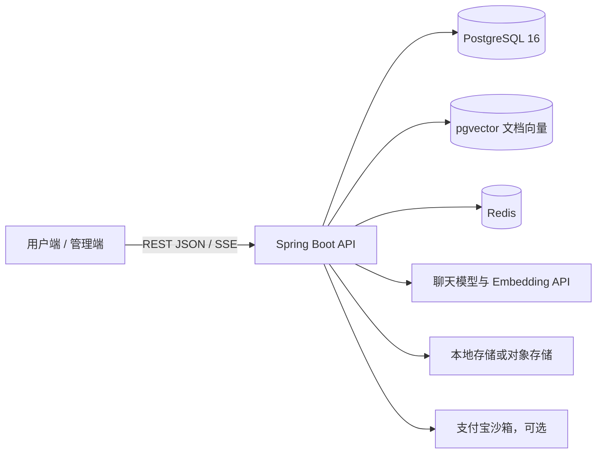

# 智能笔记

一个面向个人知识管理与协作的 AI 笔记项目。用户可以整理 Markdown 笔记和文档，把个人或共享知识库接入 AI 问答，也可以通过团队空间共同维护文档。

## 项目要解决的问题

工作资料、灵感和学习笔记常散落在不同文件中，关键词搜索不容易找回相关内容；即使找到了，也很难快速提炼重点或让团队成员共享上下文。智能笔记把笔记、文档、检索和 AI 辅助放在一套工作流里，帮助用户：

- 集中管理笔记、标签和上传的资料，并支持搜索、导出和回收。
- 让 AI 基于个人或共享知识库中的资料回答问题，减少重复查找与整理。
- 在团队中共同维护文档，通过版本记录、评论和成员权限进行协作。
- 发现、收藏和复用模板或公开分享的笔记。

这些是项目的功能目标；外部模型、对象存储和支付能力是否可用，取决于部署者自己的服务配置。

## 当前开发阶段

这是整个智能笔记项目的仓库，包含后端、用户端、管理端、数据库脚本和接口文档。2026-10-30 对新上传的前端进行了本地联调和修复，验证范围及限制见[联调报告](docs/前后端联调报告-20261030.md)。

| 部分 | 当前状态 | 技术 / 内容 |
| --- | --- | --- |
| 后端 | 已提交 | Java 17、Spring Boot 3.5、Maven |
| 数据与检索 | 已提交 | PostgreSQL 16、pgvector、Redis |
| 用户端 | 已加入并完成核心流程联调 | Vue 3、Vite 5、TypeScript、Tailwind CSS、Markdown 编辑器 |
| 管理端 | 已加入并完成核心流程联调 | Vue 3、Vite 7、TypeScript、Element Plus、Pinia、ECharts |

## 功能模块

- 账号注册、登录、验证码、用户资料、管理员用户管理。
- 笔记本、Markdown 笔记、自动保存、标签、置顶、导出和回收站。
- AI 聊天、历史会话、流式回复、笔记续写/润色/总结/翻译。
- 个人知识库文档上传、解析、向量索引、检索与引用。
- 共享知识库、成员邀请、文件管理和基于资料的 AI 对话。
- 团队空间、协作文档、锁、版本历史、评论/批注和团队 AI 会话。
- 笔记广场、模板、会员套餐、订单和管理员看板。

## 技术架构



| 技术 | 用途 |
| --- | --- |
| Java 17、Spring Boot 3.5 | REST API、业务服务、后台任务 |
| Maven | Java 依赖管理、编译与打包 |
| Sa-Token | 登录状态与角色校验 |
| MyBatis-Plus | 数据访问与分页 |
| PostgreSQL 16 | 用户、笔记、文档、协作和订单等业务数据 |
| pgvector | 存储及查询文档向量；当前 Embedding 维度为 1024 |
| Redis 6/7 | 验证码、会话记忆及缓存 |
| LangChain4j | 聊天模型、流式生成、Embedding 与知识检索 |
| 阿里云 OSS / 本地存储 | 用户上传文件的可选存储后端 |
| 支付宝沙箱 | 会员订单流程的可选支付服务 |
| Vue 3、Vite、TypeScript | 用户端和管理端页面、路由与构建 |

## 仓库结构

```text
smart-notes/
├─ .github/workflows/         # 前后端构建与前端回归检查
├─ docs/
│  ├─ 接口目录.md
│  ├─ 数据字段字典.md
│  └─ 前后端联调报告-20261030.md
├─ note-vue/                 # 用户端，开发端口 3000
├─ art-design-pro/           # 管理端，开发端口 3006
├─ initialization-note-side/
│  ├─ deploy/                 # PostgreSQL 初始化及检查 SQL
│  ├─ src/main/java/          # 后端源码
│  ├─ src/main/resources/
│  │  └─ application-example.yml
│  └─ pom.xml
└─ README.md
```

本机配置、依赖目录、构建产物和测试账号均不属于可提交的项目源码。

## 本地运行后端

### 环境要求

- JDK 17
- Maven
- PostgreSQL 16，并在数据库中安装 pgvector
- Redis 6 或 7
- AI 聊天和 Embedding 服务密钥（使用 AI 功能时）
- 文件存储配置（需要上传文件时）
- 支付宝沙箱配置（需要测试支付时）

### 配置与数据库

1. 复制 `initialization-note-side/src/main/resources/application-example.yml` 为同目录下的 `application.yml`。
2. 按自己的环境填写数据库、Redis、AI、文件存储及支付配置。请勿把含真实凭据的 `application.yml` 提交到 Git。
3. 对全新数据库执行 `initialization-note-side/deploy/init-local.sql`。已有数据库请先备份并检查迁移要求；`CREATE TABLE IF NOT EXISTS` 不会补齐旧表缺少的字段。
4. 当前向量列为 1024 维；数据库中的 pgvector 定义必须与所使用的 Embedding 模型维度一致。

同一手机号可以分别拥有用户端和管理端账号，唯一约束为 `(phone, role_type)`。如果已有数据库仍按手机号全局唯一，先备份，再执行 `initialization-note-side/deploy/migrations/20261030_account_role_uniqueness.sql`。旧管理端目录中的数据库导出已移除，请使用上述统一脚本。

可用环境变量覆盖配置示例中的值，包括：

| 配置 | 环境变量 |
| --- | --- |
| PostgreSQL | `DB_URL`、`DB_USERNAME`、`DB_PASSWORD` |
| Redis | `REDIS_HOST`、`REDIS_PORT`、`REDIS_DATABASE`、`REDIS_PASSWORD` |
| 登录签名密钥 | `JWT_SECRET_KEY` |
| 聊天模型 | `AI_CHAT_BASE_URL`、`AI_CHAT_API_KEY`、`AI_CHAT_MODEL` |
| Embedding 模型 | `AI_EMBEDDING_BASE_URL`、`AI_EMBEDDING_API_KEY`、`AI_EMBEDDING_MODEL` |
| 阿里云 OSS | `OSS_DOMAIN`、`OSS_ACCESS_KEY`、`OSS_ACCESS_SECRET`、`OSS_BUCKET`、`OSS_ENDPOINT`、`OSS_BASE_PATH` |
| 支付宝 | `ALIPAY_APP_ID`、`ALIPAY_PRIVATE_KEY`、`ALIPAY_PUBLIC_KEY`、`ALIPAY_GATEWAY_URL`、`ALIPAY_RETURN_URL`、`ALIPAY_NOTIFY_URL` |

### 在 IDEA 中运行

1. 用 IDEA 打开 `initialization-note-side/pom.xml` 并导入 Maven 项目。
2. 将 Project SDK 和 Maven Runner JDK 都设为 17。
3. 确保 PostgreSQL 和 Redis 已运行，配置文件可以连接到它们。
4. 运行主类 `com.ldd.initialization.InitializationApplication`。

后端默认监听 `http://localhost:8889`。也可以在仓库根目录执行：

```powershell
mvn -B -f initialization-note-side/pom.xml spring-boot:run
```

PostgreSQL 的默认端口是 5432；如果你的本机使用其他端口映射，需要修改 JDBC URL。端口和账号以本机配置为准。

## 本地运行前端

建议使用 Node.js 22 LTS（至少 22.12），管理端使用 pnpm 10.18.3。后端需要先运行在 8889 端口；两个前端通过 Vite 代理将 `/api` 转发给后端，浏览器访问前端地址即可。

用户端，在 `note-vue` 目录执行：

```powershell
npm ci
npm run dev
```

打开 `http://localhost:3000`。代理目标位于 `note-vue/vite.config.js`；更换后端端口时需同步修改。

管理端，在 `art-design-pro` 目录执行：

```powershell
Copy-Item .env.example .env.local
pnpm install --frozen-lockfile
pnpm dev
```

打开 `http://localhost:3006/#/auth/login`。首次配置时才复制 `.env.example`，已有 `.env.local` 请直接修改，避免覆盖本机设置。`VITE_API_PROXY_URL` 指向后端；所有 `VITE_*` 值会进入浏览器代码，不能填写模型密钥、数据库密码或 OSS 密钥。

注册的管理员处于待审核状态，需要已有管理员审核启用；普通用户账号和管理端账号按角色区分。仓库不附带默认账号或真实密码。

生产部署时用户端产物在 `note-vue/build`，管理端产物在 `art-design-pro/dist`。生产服务器需要单独配置 `/api` 反向代理，Vite 开发代理不会进入静态产物。用户端采用 history 路由，静态服务器还需为页面路由回退到 `index.html`。

## 接口与响应

- [接口目录](docs/接口目录.md)：当前 170 个后端路由，包含参数、权限、返回类型及源码位置。
- [数据字段字典](docs/数据字段字典.md)：DTO、VO 和直接返回实体的字段说明。
- 大多数 JSON 接口返回 `{code, message, data}`；分页结果通常位于 `data.data` 和 `data.total`。
- AI 流式接口使用 SSE 文本响应，不是普通 JSON；按接口目录中标注的端点约定解析。

接口文档依据当前控制器整理，并非每个路由均经过端到端测试。业务错误可能通过 HTTP 200 返回非零 `code`；上传接口还需检查文档处理状态。

## 构建与自动检查

本地构建：

```powershell
mvn -B -f initialization-note-side/pom.xml -DskipTests package
```

前端检查，分别在对应目录执行：

```powershell
# note-vue
npm test
npm run build

# art-design-pro
pnpm test
pnpm build
```

管理端构建先由 Vite 生成自动导入的类型声明，再运行 `vue-tsc --noEmit`；类型检查失败时整个构建仍失败。

GitHub Actions 使用 Java 17 打包后端，并在前端发生变更时分别安装锁定依赖、运行前端回归测试及生产构建。后端构建跳过集成测试，因为部分遗留测试需要数据库、Redis 或外部模型服务，且会修改业务数据，不能在日常使用的数据库上直接运行完整测试套件。完整业务验证仍需在隔离账号和配置好的环境中进行。

## 配置与安全

- `application.yml`、环境变量、密钥文件、IDE 配置、日志、构建产物和上传数据已加入忽略规则。
- `application-example.yml` 中的密钥均为占位符；本机配置应使用自己的凭据。
- 支付宝异步通知需要公网可访问的回调地址；本地 localhost 地址只适合本机页面跳转。
- 目前文件上传、AI、OSS 和支付依赖各自的第三方配置；未设置时相应功能无法完整工作。
