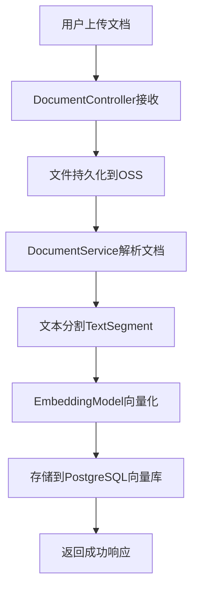
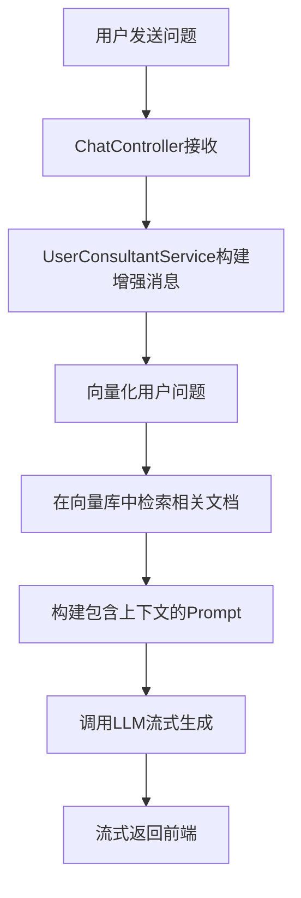

# AI助手前后端对接说明

## 一、功能概述

本次对接实现了基于个人知识库的智能AI助手功能，主要特性包括：

1. **知识库增强回答**：AI能够基于用户上传的文档内容进行回答
2. **流式输出**：实时展示AI回复内容,打字机效果
3. **会话记忆**：支持多轮对话,保持上下文连贯性
4. **用户隔离**：每个用户拥有独立的知识库和对话历史

## 二、核心流程

### 2.1 文档向量化流程（知识注入）



**关键代码位置**：
- Controller: `DocumentController.uploadDocument()`
- Service: `DocumentService.uploadAndProcessDocumentFromBytes()`
- 向量存储: `UserVectorService.ingest()`

### 2.2 智能问答流程（RAG检索增强）



**关键代码位置**：
- Controller: `ChatController.chatStream()`
- Service: `UserConsultantService.buildEnhancedMessage()`
- 检索: `UserVectorService.searchForUser()`

## 三、API接口说明

### 3.1 流式聊天接口

**接口地址**：`POST /api/chat/stream`

**请求头**：
```
Content-Type: application/json
Authorization: Bearer {token}
satoken: {token}
```

**请求参数**：
```json
{
  "memoryId": "string",  // 会话ID,用于区分不同对话
  "message": "string"     // 用户消息内容
}
```

**响应格式**：`text/event-stream` (Server-Sent Events)

**流式数据示例**：
```
根据
你上传
的文档
内容，
我来
回答...
```

**说明**：
- 每次调用会自动获取当前登录用户ID
- 系统会从用户的个人知识库中检索相关内容
- 如果找到相关文档,AI会基于文档内容回答
- 会话历史存储在Redis中,支持多轮对话

### 3.2 文档上传接口

**接口地址**：`POST /api/documents/upload`

**请求头**：
```
Content-Type: multipart/form-data
Authorization: Bearer {token}
satoken: {token}
```

**请求参数**：
- `file`: 文件对象 (支持 .md, .txt, .doc, .pdf)

**响应示例**：
```json
{
  "code": 200,
  "message": "success",
  "data": {
    "id": 123,
    "originalFilename": "test.pdf",
    "fileSize": 1024000,
    "documentCount": 15,
    "processingStatus": "SUCCESS",
    "processingMessage": "文档上传并处理成功"
  }
}
```

## 四、前端实现说明

### 4.1 目录结构

```
note-vue/
├── src/
│   ├── api/
│   │   └── chat.js           # 聊天API接口
│   ├── views/
│   │   └── AIChat/
│   │       └── index.vue     # AI聊天主页面
│   ├── components/
│   │   └── chat/
│   │       ├── ChatDialog.vue    # 对话组件
│   │       └── ChatHistory.vue   # 历史会话列表
│   └── types/
│       └── chat.js           # 类型定义
```

### 4.2 核心代码改动

#### chat.js - API接口
```javascript
export async function sendChatMessageStream({ memoryId, message }) {
  const token = localStorage.getItem('satoken') || '';
  
  const response = await fetch('/api/chat/stream', {
    method: 'POST',
    headers: {
      'Content-Type': 'application/json',
      'Authorization': `Bearer ${token}`,
      'satoken': token,
    },
    body: JSON.stringify({ memoryId, message })
  });

  return response.body; // 返回ReadableStream
}
```

#### AIChat/index.vue - 流式处理
```javascript
// 读取流式响应
const reader = stream.getReader()
const decoder = new TextDecoder()
let accumulatedContent = ''

while (true) {
  const { done, value } = await reader.read()
  if (done) break

  const chunk = decoder.decode(value, { stream: true })
  accumulatedContent += chunk

  // 实时更新AI消息内容
  updateMessageContent(accumulatedContent)
}
```

### 4.3 主要改动点

1. **移除模拟数据**：删除了`getAIResponse()`和`initialSessions`等模拟代码
2. **使用真实API**：调用后端`/api/chat/stream`接口
3. **流式渲染**：使用ReadableStream实时更新消息内容
4. **会话管理**：前端维护会话列表,使用memoryId关联后端会话记忆

## 五、后端核心实现

### 5.1 关键配置

**application.yml**:
```yaml
langchain4j:
  open-ai:
    chat-model:
      base-url: https://api.deepseek.com
      api-key: sk-xxx
      model-name: deepseek-chat
    embedding-model:
      base-url: https://dashscope.aliyuncs.com/compatible-mode/v1
      api-key: sk-xxx
      model-name: text-embedding-v3
```

### 5.2 系统提示词

位置: `resources/system.txt` (如果不存在,使用默认提示词)

默认提示词重点：
- 优先基于用户上传的文档内容回答
- 明确区分「参考资料」和「通用建议」
- 回答简洁、准确,突出关键信息

### 5.3 向量检索策略

**UserVectorService.searchForUser()** 参数:
- `userId`: 用户ID (确保数据隔离)
- `query`: 用户问题
- `maxResults`: 最多返回10个相关片段
- `minScore`: 最小相似度阈值 0.3

**数据过滤**:
```sql
WHERE user_id = ? 
  AND knowledge_base_type = 1  -- 个人知识库
ORDER BY embedding <=> query_embedding  -- 余弦距离排序
LIMIT 10
```

## 六、技术栈

### 前端
- Vue 3 (Composition API)
- TypeScript
- Fetch API (流式处理)
- Tailwind CSS

### 后端
- Spring Boot 3.x
- LangChain4j (AI编排框架)
- PostgreSQL + pgvector (向量数据库)
- Redis (会话存储)
- WebFlux (响应式流式输出)

## 七、测试验证

### 7.1 上传文档测试

```bash
curl -X POST http://localhost:8889/api/documents/upload \
  -H "Authorization: Bearer {token}" \
  -F "file=@test.pdf"
```

### 7.2 聊天测试

前端直接在AI助手页面发送消息即可，观察：
1. 是否能正确流式输出
2. 回答是否基于上传的文档内容
3. 多轮对话是否保持上下文

### 7.3 诊断接口

```bash
# 测试向量化功能
GET http://localhost:8889/api/documents/test-vector

# 测试文档解析
POST http://localhost:8889/api/documents/test-parse
```

## 八、注意事项

### 8.1 Token认证
- 前端使用`localStorage.getItem('satoken')`获取token
- 需要同时设置`Authorization`和`satoken`两个header
- 401错误时会自动清除本地token

### 8.2 会话管理
- `memoryId`由前端生成并维护
- 格式建议: `{userId}_{timestamp}` 或简单的时间戳
- Redis会话默认保存1天

### 8.3 文档限制
- 单文件最大10MB
- 支持格式: .md, .txt, .doc, .pdf
- 非PDF格式会自动转换为PDF处理

### 8.4 性能优化
- 文档处理为异步操作,不阻塞上传响应
- 流式输出有速率控制,避免过快传输
- 向量检索限制返回数量,控制上下文长度

## 九、常见问题

### Q1: AI没有基于文档内容回答?
**排查步骤**:
1. 检查文档是否上传成功 (`processingStatus: SUCCESS`)
2. 调用 `/api/documents/test-vector` 检查向量化是否正常
3. 查看后端日志,确认检索到了相关内容

### Q2: 流式输出卡住不动?
**可能原因**:
1. 网络连接中断
2. LLM API超时
3. 前端Reader未正确处理done状态

### Q3: 多轮对话失去上下文?
**检查**:
- 每次请求是否使用同一个`memoryId`
- Redis是否正常运行
- 会话是否过期(默认1天)

## 十、后续优化方向

1. **会话持久化**: 将会话列表保存到数据库,支持跨设备同步
2. **文档管理**: 在聊天界面展示已上传文档,支持选择特定文档问答
3. **引用溯源**: 在回答中标注参考了哪些文档片段
4. **多知识库**: 支持在个人知识库和共享知识库间切换
5. **语音输入**: 集成语音识别功能

---

**更新时间**: 2025-12-14
**维护者**: AI开发团队
