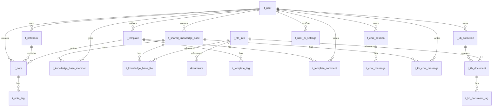

# 数据库初始化脚本 v2 说明

## 设计目标
- 保持与现有接口完全兼容：保留既有表与字段，不对现有 API 语义造成破坏
- 明确主外键关系与级联规则：保障删除与更新的业务一致性
- 补充高频索引与可选 ANN 索引：满足列表、检索与向量搜索性能需求
- 扩展满足前端已使用的模拟数据实体：模板中心、聊天系统、个人知识库

## 覆盖的核心模块
- 用户、文件：`t_user`、`t_file_info`
- 笔记系统：`t_notebook`、`t_note`、`t_note_tag`（新增：`origin_template_id`）
- 共享知识库：`t_shared_knowledge_base`、`t_knowledge_base_member`、`t_knowledge_base_file`
- 文档向量：`documents`（pgvector，新增 ANN 索引与清理触发器）
- 模板中心：`t_template`、`t_template_tag`、`t_template_comment`
- 聊天系统：`t_chat_session`、`t_chat_message`、`t_kb_chat_message`
- 个人知识库：`t_kb_collection`、`t_kb_document`、`t_kb_document_tag`
- 用户AI设置：`t_user_ai_settings`（与 Settings 页面字段一一对应）

## 实体关系图

## 关键设计决策
- 不改变已存在的字段类型与语义，新增实体与列均以可选/可空方式引入
- 外键级联规则：
  - 删除用户：`t_notebook/t_note/t_note_tag/t_chat_session/t_chat_message/t_kb_collection` 级联清理，文件 `t_file_info` 依据 FK 策略清理
  - 删除笔记本：`t_note.notebook_id` 置空，避免误删笔记
  - 删除共享 KB：成员与文件映射级联清理；新增触发器清理 `documents` 中的共享向量数据
  - 删除模板作者/评论作者：置空作者字段，不影响模板与评论实体
- 向量检索：建立 `ivfflat` ANN 索引并建议配合过滤索引，满足 KB/用户维度的快速召回
- 更新时间戳：统一触发器函数维护 `update_time/updated_at`，避免应用层漏更新
- 用户AI设置：一用户一配置（`uk(user_id)`），删除用户级联清理，字段包含开关、最大文档数、风格与语言枚举、API端点与密钥等

## 与前端需求的映射
- 模板中心：`t_template(+tags,+comments)` 支持分类、评分、下载量、更新时间排序与详情页评论列表
- 聊天系统：`t_chat_session/t_chat_message` 支持会话列表与消息加载；`t_kb_chat_message` 支持 KB 内置对话
- 个人知识库：`t_kb_collection/t_kb_document(+tags_json,+file)` 支持集合分类、索引状态、分块统计与文档标签
- 笔记派生模板：`t_note.origin_template_id` 记录来源模板，保证数据可追溯
- 向量与文件：`documents.file_id -> t_file_info.id` 确保删除文件时清理相关向量

## 版本迁移注意事项
1. 扩展与权限
   - 确认安装 `vector` 与 `pgcrypto` 扩展
   - 目标 schema 为 `public`，表所有者设置为 `postgres`
2. 新增表与列
   - 新增实体不影响现有接口；`t_note.origin_template_id` 为可空列
3. 外键与触发器
   - 通过存在性判断创建（`pg_constraint/pg_trigger`），避免重复执行错误
   - 若历史数据违反外键，需事先梳理并修复（例如孤儿 `t_kb_document`）
4. 索引
   - ANN 索引需要合理的 `lists/probes` 参数，满足线上查询的时延与精度
5. 数据迁移策略（存量库）
   - 先部署只读校验脚本，确认约束与索引可创建
   - 逐步引入触发器并观察写入性能与 VACUUM 影响
   - 对高写入表考虑后续分区方案
   - 如需回滚 AI 设置，执行 `SELECT public.fn_migration_v2_ai_settings_down();`

## 版本变更记录
- v2
  - 新增：模板中心、聊天系统、个人知识库实体
  - 增强：多处外键与复合索引、ANN 索引、统一更新时间戳触发器
  - 兼容：保留既有表与字段、不更改字段类型
  - 清理：共享 KB 删除时自动清理 `documents` 相关向量

## 执行与验证方案
1. 执行前检查
   - 确认数据库为 PostgreSQL 且具备 `vector/pgcrypto` 扩展
   - 备份现有数据（生产环境）
2. 执行
   - 运行 `docs/sql_init_v2.sql`，确保事务成功
3. 执行后自检
   - 表与索引存在校验：`SELECT ... FROM pg_tables/pg_indexes/pg_constraint/pg_trigger`
   - 外键级联验证：删除用户/KB/文件时相关数据是否符合预期
   - 向量检索验证：插入向量后进行 ANN 查询并评估时延
4. 测试用例
   - 参考 `docs/db_validation_tests.sql`，包含约束边界、唯一性、级联与性能相关测试

## 附：接口兼容性说明
- 认证接口（`/api/common/*`）依赖 `t_user`，保持不变
- 文件上传与引用依赖 `t_file_info`，新增 FK 与索引不影响现有写入流程
- 笔记/笔记本接口保持字段与语义一致；新增 `origin_template_id` 可忽略
- 新增实体用于前端扩展功能，不影响现有接口联调
