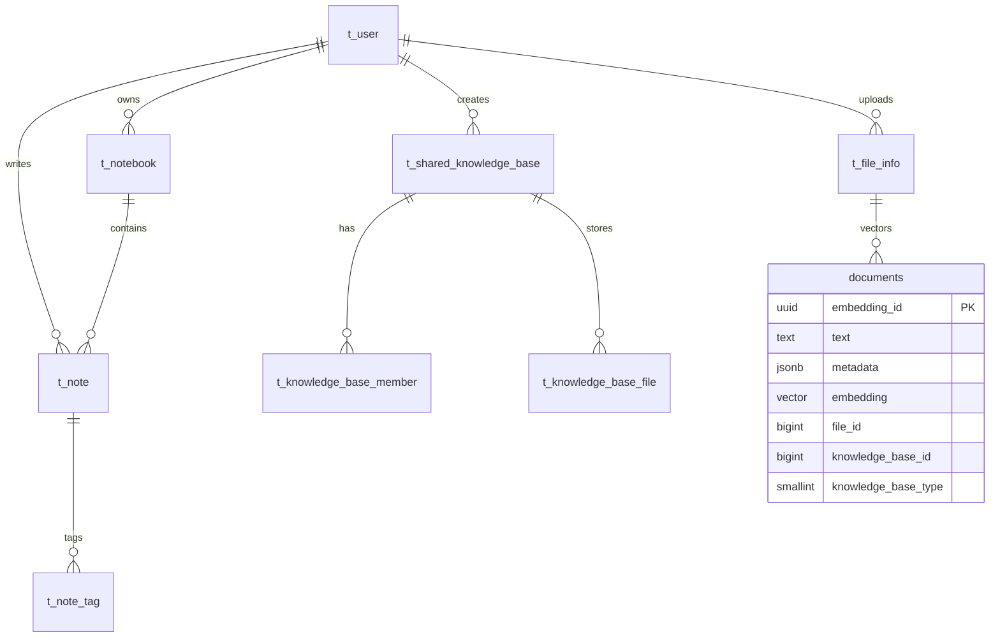

# 数据模型定义与ER图（v0.1）

## 数据字典（复用）
- `t_user`
  - `id bigserial PK`，`phone varchar(11) unique not null`，`password varchar(100)`，`role_type smallint not null`，`username varchar(50)`，`avatar_url varchar(255)`，`real_name varchar(50)`，`id_card varchar(18)`，`gender smallint`，`birth_date date`，`work_years smallint`，`education smallint`，`status smallint default 1`，`last_login_time timestamp`，`last_login_ip varchar(50)`，`create_time timestamp`，`update_time timestamp`
- `t_notebook`
  - `id bigserial PK`，`name varchar(128) not null`，`description text`，`color varchar(7)`，`user_id bigint not null`，`create_time timestamp`，`update_time timestamp`，`sort_order integer`
- `t_note`
  - `id bigserial PK`，`title varchar(255) not null`，`content_md text`，`content_html text`，`notebook_id bigint`，`user_id bigint not null`，`is_pinned boolean default false`，`status smallint default 1`，`create_time timestamp`，`update_time timestamp`，`view_count integer`，`word_count integer`
- `t_note_tag`
  - `id bigserial PK`，`note_id bigint not null`，`tag_name varchar(50) not null`，`create_time timestamp`，唯一 `(note_id, tag_name)`
- `t_shared_knowledge_base`
  - `id bigserial PK`，`name varchar(128) not null`，`description text`，`cover_url varchar(255)`，`password varchar(100)`，`creator_id bigint not null`，`is_public boolean default true`，`member_count integer default 1 check >=0`，`file_count integer default 0 check >=0`，`status smallint default 1 check in(0,1)`，`create_time timestamp`，`update_time timestamp`
- `t_knowledge_base_member`
  - `id bigserial PK`，`knowledge_base_id bigint not null`，`user_id bigint not null`，`role smallint default 2 check in(1,2)`，`join_time timestamp`，唯一 `(knowledge_base_id, user_id)`
- `t_knowledge_base_file`
  - `id bigserial PK`，`knowledge_base_id bigint not null`，`file_id bigint not null`，`uploader_id bigint not null`，`source_type smallint default 1 check in(1,2)`，`upload_time timestamp`，唯一 `(knowledge_base_id, file_id)`
- `t_file_info`
  - `id bigserial PK`，`original_filename varchar(255)`，`file_name varchar(255)`，`file_extension varchar(50)`，`file_size bigint`，`file_path text`，`file_url text`，`user_id bigint`，`file_md5 varchar(32)`，`create_time timestamp`，`update_time timestamp`，`file_type varchar(50)`，`mime_type varchar(100)`，`file_hash varchar(64)`，`source_type smallint default 1`，`source_note_id bigint`，`source_note_title varchar(255)`
- `documents`
  - `embedding_id uuid default gen_random_uuid() PK`，`user_id varchar(100)`，`text text not null`，`metadata jsonb`，`embedding vector`，`created_at timestamp(6)`，`file_id bigint`，`knowledge_base_id bigint`，`knowledge_base_type smallint default 1`
  - 索引：`created_at`、`embedding_id`、`GIN(metadata)`、`user_id, created_at`、`user_id`、`file_id`、`file_id,user_id`、`knowledge_base_type`、`knowledge_base_id,knowledge_base_type`

## 新增数据实体（可选）
- `t_shared_knowledge_base_tag`
  - 字段：`id bigserial PK`，`knowledge_base_id bigint not null`，`tag_name varchar(64) not null`，`create_time timestamp default CURRENT_TIMESTAMP`
  - 约束：`UNIQUE (knowledge_base_id, tag_name)`
- `t_kb_invite`
  - 字段：`id bigserial PK`，`knowledge_base_id bigint not null`，`code varchar(64) unique not null`，`expire_at timestamp`，`max_uses integer default 1 check (max_uses >= 1)`，`used_count integer default 0 check (used_count >=0)`，`create_time timestamp default CURRENT_TIMESTAMP`
- 字段：`t_file_info.download_count integer default 0 check (download_count >=0)`
- 向量索引：`CREATE INDEX IF NOT EXISTS idx_documents_embedding_hnsw ON public.documents USING hnsw (embedding vector_cosine_ops);`

## 关系与约束
- 用户→笔记本/笔记/文件/共享KB：一对多
- 共享KB→成员/文件：一对多
- 文件→向量文档：一对多（通过 `file_id`）
- 向量文档→知识库：多对一（通过 `knowledge_base_id` + `knowledge_base_type`）

## ER 图

