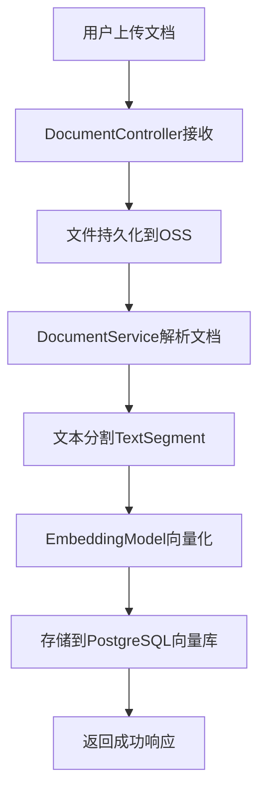
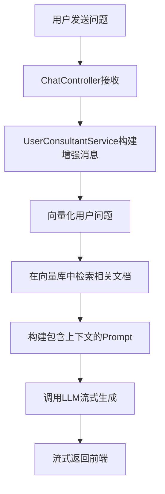

# 更新变更报告（登录注册前后端对接与开发支持）

---

# API响应码与数据格式修复

## 变更时间
- 2025-12-14 23:58 修复前端响应码判断和数据结构匹配问题

## 问题描述

1. **问题一：共享知识库创建后不显示**
   - 原因：后端API返回 `code: 0` 表示成功，但前端检查的是 `res.code === 200`
   - 影响：所有共享知识库的API调用均无法正确处理响应

2. **问题二：App.vue加载笔记失败**
   - 错误：`Cannot read properties of undefined (reading 'map')`
   - 原因：前端访问 `res.data.records`，但后端 `PageResult` 类使用 `data` 字段

## 修复内容

### SharedKnowledgeBase/index.vue
- 将所有 `res.code === 200` 修改为 `res.code === 0`
- 受影响的方法：
  - `loadSquareKnowledgeBases()`
  - `loadCreatedKnowledgeBases()`
  - `loadJoinedKnowledgeBases()`
  - `loadKnowledgeBaseDetail()`
  - `loadKnowledgeBaseFiles()`
  - `loadKnowledgeBaseMembers()`
  - `confirmJoin()`
  - `leaveKnowledgeBase()`
  - `handleCreateKnowledgeBase()`
  - `deleteKnowledgeBase()`
  - `deleteFile()`
  - `removeMember()`

### App.vue
- 修改 `loadNotesList()` 中的数据访问：
  - 原：`res.data.records.map(transformNote)`
  - 新：`(res.data.data || res.data.records || []).map(transformNote)`
- 兼容后端 `PageResult.data` 和可能的 `records` 字段

## 原因总结
- 后端API统一使用 `code: 0` 表示成功，而非 HTTP 状态码 200
- `PageResult` 类的分页数据字段名为 `data` 而非 `records`

---

# 共享知识库前后端数据对接

## 变更时间
- 2025-12-14 23:46 完成共享知识库页面前后端数据对接

## 修改项详情

### 新增的功能或内容

1. **新增 sharedKnowledge.js API模块**
   - 位置：`note-vue/src/api/sharedKnowledge.js`
   - 功能：封装共享知识库所有后端 API 调用
   - 接口列表：
     - `createKnowledgeBase(data)` - 创建共享知识库
     - `updateKnowledgeBase(id, data)` - 更新知识库
     - `deleteKnowledgeBase(id)` - 删除知识库
     - `getKnowledgeBaseDetail(id)` - 获取知识库详情
     - `getMyCreatedKnowledgeBases()` - 获取我创建的知识库
     - `getMyJoinedKnowledgeBases()` - 获取我加入的知识库
     - `getKnowledgeBaseSquare(params)` - 知识库广场搜索
     - `joinKnowledgeBase(data)` - 加入知识库
     - `leaveKnowledgeBase(id)` - 退出知识库
     - `getKnowledgeBaseMembers(id)` - 获取成员列表
     - `removeMember(kbId, userId)` - 移除成员
     - `uploadKnowledgeBaseFile(kbId, file)` - 上传文件
     - `getKnowledgeBaseFiles(kbId, params)` - 获取文件列表
     - `deleteKnowledgeBaseFile(kbId, fileId)` - 删除文件
     - `copyFilesToKnowledgeBase(kbId, fileIds)` - 复制文件到知识库
     - `getPersonalFilesForCopy()` - 获取可复制的个人文件
     - `chatWithKnowledgeBaseStream(kbId, message)` - AI流式对话

### 修改的现有功能或内容

1. **SharedKnowledgeBase/index.vue - 完全重构数据管理**
   - 移除模拟数据 `mockSquareKnowledgeBases`、`mockFiles`、`mockMembers`
   - 新增数据加载方法：
     - `loadSquareKnowledgeBases()` - 加载广场知识库列表
     - `loadCreatedKnowledgeBases()` - 加载我创建的
     - `loadJoinedKnowledgeBases()` - 加载我加入的
     - `loadKnowledgeBaseDetail(id)` - 加载知识库详情
     - `loadKnowledgeBaseFiles(id)` - 加载文件列表
     - `loadKnowledgeBaseMembers(id)` - 加载成员列表
   - 改造事件处理方法：
     - `viewKnowledgeBase()` - 调用API加载详情
     - `confirmJoin()` - 调用API加入知识库
     - `leaveKnowledgeBase()` - 调用API退出
     - `handleCreateKnowledgeBase()` - 调用API创建/更新
     - `deleteKnowledgeBase()` - 调用API删除
     - `handleUploadFiles()` - 调用API上传文件
     - `deleteFile()` - 调用API删除文件
     - `removeMember()` - 调用API移除成员
     - `sendKbMessage()` - 调用API流式AI对话
   - 添加生命周期钩子 `onMounted` 自动加载数据
   - 添加 `loading` 状态管理
   - 添加 `currentUserId` 从本地存储获取

2. **api/index.js - 更新导出**
   - 新增导出 `export * from './sharedKnowledge'`
   - 添加其他API模块统一导出

### 后端接口对应

| 前端API方法 | 后端接口 | HTTP方法 |
|-----------|----------|------------|
| createKnowledgeBase | /api/shared-knowledge-base | POST |
| updateKnowledgeBase | /api/shared-knowledge-base/{id} | PUT |
| deleteKnowledgeBase | /api/shared-knowledge-base/{id} | DELETE |
| getKnowledgeBaseDetail | /api/shared-knowledge-base/{id} | GET |
| getMyCreatedKnowledgeBases | /api/shared-knowledge-base/my-created | GET |
| getMyJoinedKnowledgeBases | /api/shared-knowledge-base/my-joined | GET |
| getKnowledgeBaseSquare | /api/shared-knowledge-base/square | GET |
| joinKnowledgeBase | /api/shared-knowledge-base/join | POST |
| leaveKnowledgeBase | /api/shared-knowledge-base/{id}/leave | POST |
| getKnowledgeBaseMembers | /api/shared-knowledge-base/members/{id} | GET |
| removeMember | /api/shared-knowledge-base/members/{userId}/{kbId} | DELETE |
| uploadKnowledgeBaseFile | /api/shared-knowledge-base/{id}/files/upload | POST |
| getKnowledgeBaseFiles | /api/shared-knowledge-base/{id}/files | GET |
| deleteKnowledgeBaseFile | /api/shared-knowledge-base/{id}/files/{fileId} | DELETE |
| chatWithKnowledgeBaseStream | /api/shared-knowledge-base/chat/stream | POST |

## 原因与影响范围总结
- 原因：实现前后端真实数据交互，移除模拟数据，完成共享知识库功能的完整对接
- 影响范围：
  - 前端：SharedKnowledgeBase/index.vue、sharedKnowledge.js API模块
  - 功能：知识库广场浏览、创建/编辑/删除知识库、加入/退出知识库、文件管理、成员管理、AI对话

## 联调与验证
- 知识库广场：`GET /api/shared-knowledge-base/square` 返回公开知识库列表
- 我创建的：`GET /api/shared-knowledge-base/my-created` 返回用户创建的知识库
- 我加入的：`GET /api/shared-knowledge-base/my-joined` 返回用户加入的知识库
- 知识库详情：`GET /api/shared-knowledge-base/{id}` 返回知识库详细信息
- 创建知识库：`POST /api/shared-knowledge-base` 创建新知识库
- 加入知识库：`POST /api/shared-knowledge-base/join` 加入指定知识库
- 文件上传：`POST /api/shared-knowledge-base/{id}/files/upload` 上传文件
- AI对话：`POST /api/shared-knowledge-base/chat/stream` 流式AI对话

## 备注
- 前端类型警告（Vetur模块解析）不影响实际运行
- 数据转换层确保前后端数据结构解耦
- 所有API调用均带有错误处理和日志记录
- AI对话使用SSE流式输出，支持实时显示

---

# 笔记功能模块前后端数据对接

## 变更时间
- 2025-12-14 23:25 完成笔记功能模块前后端数据对接

## 修改项详情

### 新增的功能或内容

1. **新增 notes.js API 模块**
   - 位置：`note-vue/src/api/notes.js`
   - 功能：封装笔记本和笔记的所有后端 API 调用
   - 接口列表：
     - `getNotebooks()` - 获取用户笔记本列表
     - `createNotebook(data)` - 创建笔记本
     - `updateNotebook(id, data)` - 更新笔记本
     - `deleteNotebook(id)` - 删除笔记本
     - `getNotes(params)` - 分页获取笔记列表
     - `getNoteDetail(id)` - 获取笔记详情
     - `createNote(data)` - 创建笔记
     - `updateNote(data)` - 更新笔记
     - `autoSaveNote(data)` - 自动保存笔记
     - `deleteNote(id)` - 删除笔记
     - `togglePinNote(id)` - 切换置顶状态
     - `getUserTags()` - 获取用户标签
     - `addNoteToKnowledgeBase(id)` - 添加笔记到知识库

### 修改的现有功能或内容

1. **App.vue - 完全重构笔记数据管理**
   - 移除模拟数据 `initialNotebooks` 和 `initialNotes`
   - 新增数据转换函数：
     - `transformNote()` - 后端数据转换为前端格式
     - `transformNotebook()` - 笔记本数据转换
   - 新增数据加载方法：
     - `loadNotebooks()` - 加载笔记本列表
     - `loadNotesList()` - 加载笔记列表
     - `loadNoteDetail()` - 加载笔记详情
     - `initData()` - 初始化数据
   - 改造事件处理方法：
     - `handleCreateNote()` - 调用API创建笔记
     - `handleUpdateNote()` - 调用API更新笔记
     - `handleDeleteNote()` - 调用API删除笔记
     - `handleTogglePin()` - 调用API切换置顶
     - `handleSelectNote()` - 选择笔记时加载详情
     - `handleFilterChange()` - 筛选变更时重新加载数据
   - 添加生命周期钩子 `onMounted` 自动加载数据
   - 添加 `watch` 监听登录状态变化

2. **NoteList.vue - 增强空值安全处理**
   - 修改 `getPreviewText()` 支持 undefined/null
   - 新增 `getNoteTags()` 安全获取标签数组
   - 避免后端返回数据字段缺失导致的错误

3. **NoteEditor.vue - 实现添加到知识库API调用**
   - 导入 `addNoteToKnowledgeBase` API
   - 新增 `addingToKb` 加载状态
   - 重写 `handleAddToKnowledgeBase()` 方法：
     - 调用后端API `/api/notes/{noteId}/add-to-knowledge-base`
     - 显示加载状态和操作结果反馈

### 数据字段映射

| 后端字段 | 前端字段 | 说明 |
|---------|---------|------|
| id (Long) | id (string) | ID转换为字符串 |
| notebookId (Long) | notebookId (string) | 笔记本ID转换 |
| contentMd | content | Markdown内容字段名映射 |
| createTime | createdAt (Date) | 时间戳转换为Date对象 |
| updateTime | updatedAt (Date) | 时间戳转换为Date对象 |
| isPinned | isPinned | 直接映射 |
| tags | tags | 直接映射，防空null处理 |

## 原因与影响范围总结
- 原因：实现前后端真实数据交互，移除模拟数据，完成笔记功能的完整对接
- 影响范围：
  - 前端：App.vue、NoteList.vue、NoteEditor.vue、notes.js API模块
  - 功能：笔记的增删改查、笔记本管理、置顶功能、添加到知识库

## 联调与验证
- 笔记本接口：`GET /api/notebooks` 正常返回用户笔记本列表
- 笔记列表接口：`GET /api/notes` 正常返回分页笔记数据
- 笔记详情接口：`GET /api/notes/{id}` 正常返回笔记内容
- 创建笔记接口：`POST /api/notes` 正常创建新笔记
- 更新笔记接口：`POST /api/notes/update` 正常更新笔记内容
- 删除笔记接口：`DELETE /api/notes/{id}` 正常删除笔记
- 置顶接口：`POST /api/notes/{id}/pin` 正常切换置顶状态
- 知识库接口：`POST /api/notes/{id}/add-to-knowledge-base` 正常添加到知识库

## 备注
- 前端类型警告（Vetur模块解析）不影响实际运行
- 数据转换层确保前后端数据结构解耦
- 所有API调用均带有错误处理和日志记录

---

# AI助手Markdown渲染支持

## 变更时间
- 2025-12-14 23:00 AI消息支持Markdown格式渲染
- 2025-12-14 23:05 修复流式输出时loading动画不消失的bug
- 2025-12-14 23:09 修复英文字符不换行导致对话框无限横向延伸的bug
- 2025-12-14 23:11 修复SSE解析时trim删除空格导致英文单词粘连的bug（关键修复）
- 2025-12-14 23:13 优化AI回复的段落间距，提升可读性

## 修改项详情

### 修复的问题或缺陷
1. **流式输出时同时显示两个气泡的bug**
   - 问题描述：AI回复时，同时出现两个气泡：
     - 上面是AI的实际回复内容
     - 下面是三个点的加载动画（loading indicator）
   - 原因分析：
     - 流式输出开始后，先创建了一个空的AI消息占位符
     - 同时`isLoading`状态仍为`true`，所以loading动画也在显示
     - 当数据开始填充到AI消息时，两个气泡同时显示
     - 直到整个流式响应完成后，`finally`块中才设置`isLoading = false`
   - 修复方案：
     - 在接收到第一个数据块时，立即将`isLoading`设为`false`
     - 这样当AI开始输出内容时，三个点的加载动画就会立即消失
     - 只显示一个气泡：包含流式输出内容的AI消息
   - 修改文件：`note-vue/src/views/AIChat/index.vue`
   - 代码修改：
     ```typescript
     (chunk: string) => {
       // 接收到第一个数据块时，隐藏loading状态
       if (isLoading.value) {
         isLoading.value = false
       }
       
       // 接收到新的数据块
       accumulatedContent += chunk
       // ...
     }
     ```

2. **英文字符不换行导致对话框无限横向延伸的bug**
   - 问题描述：
     - 输出英文时，每个英文字符之间没有空格
     - 长单词或连续字符串不会自动换行
     - 导致对话框无限横向延伸，破坏布局
   - 原因分析：
     - CSS没有设置正确的文本换行规则
     - 默认情况下，浏览器只在空格、连字符等处换行
     - 当没有合适的换行点时，内容就会溢出
   - 修复方案：
     - 为消息内容添加 `break-all` 和 `overflow-wrap: anywhere` 样式
     - 为Markdown所有元素添加通用换行规则
     - 特别处理代码块，使用 `white-space: pre-wrap` 和 `word-break: break-all`
     - 设置 `max-width: 100%` 防止容器溢出
   - 修改文件：`note-vue/src/components/chat/ChatDialog.vue`
   - CSS修改：
     ```css
     /* 消息内容 */
     .markdown-content {
       word-wrap: break-word;
       overflow-wrap: anywhere;
       word-break: break-word;
     }
     
     /* 所有元素 */
     .markdown-content :deep(*) {
       word-wrap: break-word;
       overflow-wrap: anywhere;
     }
     
     /* 代码块 */
     .markdown-content :deep(pre code) {
       white-space: pre-wrap;
       word-break: break-all;
     }
     ```
   - HTML class修改：
     ```html
     <p class="whitespace-pre-wrap break-words break-all">
     <div class="markdown-content whitespace-pre-wrap break-words break-all overflow-wrap-anywhere">
     ```

3. **SSE解析时trim删除空格导致英文单词粘连的bug（核心问题）**
   - 问题描述：
     - AI输出英文时，所有单词连在一起，没有空格
     - 例如：`ProtectingOurEnvironmentThereexist...`
     - 应该是：`Protecting Our Environment There exist...`
   - 原因分析：
     - 在SSE解析代码中，使用了 `.trim()` 方法删除首尾空格
     - 流式输出时，后端按token/单词分块发送，每块后面都带有空格
     - 前端接收：`"data: Protecting "` → `trim()` → `"Protecting"`（空格被删！）
     - 下一块：`"data: Our "` → `trim()` → `"Our"`（空格被删！）
     - 拼接结果：`"ProtectingOur"`（单词粘连）
   - 修复方案：
     - **关键修改**：移除所有 `.trim()` 调用
     - 只移除 `"data:"` 前缀，保留内容中的**所有空格**
     - 只跳过完全空的行（`content.length > 0` 而不是 `content.trim()`）
   - 修改文件：`note-vue/src/api/chat.js`
   - 代码修改：
     ```javascript
     // 修改前（错误）
     const content = line.substring(5).trim(); // 移除 "data:" 前缀
     if (content) {  // trim后的空字符串为falsy
       onChunk(content);
     }
     
     // 修改后（正确）
     const content = line.substring(5); // 只移除 "data:"，保留空格！
     if (content.length > 0) {  // 只要有内容就发送（包括空格）
       onChunk(content);
     }
     ```
   - 影响范围：
     - 解决了英文输出时单词粘连的根本问题
     - 保证AI回复中的所有空格和格式都被正确保留
     - 中文输出不受影响

### 优化项
1. **AI回复的段落间距优化**
   - 问题描述：
     - 所有输出内容都挤在一个段落里
     - 段落间没有明显的分隔，阅读很吃力
   - 优化方案：
     - **移除 `whitespace-pre-wrap` 类**：让Markdown自然处理空白符和段落
     - **增加段落间距**：从 `0.5em` 增加到 `0.75em`
     - **增强行高**：段落行高设置为 `1.8`，更便于阅读
     - **优化首尾边距**：移除第一个段落的上边距和最后一个段落的下边距
   - 修改文件：`note-vue/src/components/chat/ChatDialog.vue`
   - CSS修改：
     ```css
     /* 段落间距 - 增强段落分隔 */
     .markdown-content :deep(p) {
       margin: 0.75em 0;  /* 增加段落间距 */
       line-height: 1.8;   /* 增强行高 */
     }
     
     /* 移除第一个段落的上边距 */
     .markdown-content :deep(p:first-child) {
       margin-top: 0;
     }
     
     /* 移除最后一个段落的下边距 */
     .markdown-content :deep(p:last-child) {
       margin-bottom: 0;
     }
     ```
   - HTML class修改：
     ```html
     <!-- 移除了 whitespace-pre-wrap，让Markdown自然处理段落 -->
     <div class="markdown-content break-words break-all overflow-wrap-anywhere">
     ```
   - 效果：
     - 段落之间有明显的读分隔
     - 行间距更宽松，阅读更舒适
     - Markdown自动处理换行和段落
     - 保持单词间空格和正确换行

### 新增的功能或内容
1. **Markdown渲染支持**
   - 安装 `marked` 库（轻量级Markdown解析器）
   - 修改 `ChatDialog.vue` 组件：
     - 导入 `marked` 库并配置选项（启用GitHub风格的Markdown和换行支持）
     - 添加 `renderMarkdown` 函数将Markdown文本转换为HTML
     - AI消息使用 `v-html` 渲染Markdown内容
     - 用户消息保持纯文本显示
   - 添加完整的Markdown样式表：
     - 标题样式（h1/h2/h3带下划线）
     - 列表样式（ul/ol缩进与间距）
     - 代码块样式（灰色背景、等宽字体）
     - 引用样式（左侧边框、斜体）
     - 表格样式（边框、表头背景）
     - 链接样式（蓝色、下划线、hover效果）
     - 加粗、斜体、水平线等

### 修改的文件
1. **`package.json`**
   - 新增依赖：`marked`
   
2. **`note-vue/src/components/chat/ChatDialog.vue`**
   - 导入并配置 `marked` 库
   - 添加 `renderMarkdown` 函数
   - 修改消息渲染逻辑：
     - 用户消息：`<p>{{ message.content }}</p>`（纯文本）
     - AI消息：`<div v-html="renderMarkdown(message.content)"></div>`（Markdown渲染）
   - 新增 `<style scoped>` 样式块，包含所有Markdown元素的样式

### 功能说明

**支持的Markdown语法：**
- **标题**：# H1、## H2、### H3
- **列表**：有序列表(1. 2. 3.)、无序列表(- * +)
- **代码**：行内代码 \`code\`、代码块 \`\`\`
- **引用**：> 引用文本
- **强调**：**加粗**、*斜体*
- **链接**：[文本](URL)
- **表格**：Markdown表格语法
- **水平线**：---
- **换行**：GitHub风格的换行（单个回车即换行）

**样式特点：**
- 标题带下划线，层级清晰
- 代码块浅灰色背景，易于区分
- 列表有合适的缩进和间距
- 引用有左侧边框和斜体
- 表格有边框和表头背景色
- 整体风格简洁专业

### 已知问题说明

**~~关于"两个对话"的问题：~~** （已修复）

原问题：用户反馈"ai在回答时，会有两个对话，下面那个是三个点"。

问题原因：
- 流式输出开始后，同时显示了AI消息和loading动画
- loading动画在整个流式响应完成前不会消失

解决方案：
- 当接收到第一个数据块时，立即隐藏loading动画
- 现在只会显示一个气泡：包含流式输出内容的AI消息

### 影响范围
- AI助手聊天界面的消息显示效果
- 所有AI回复都将以Markdown格式渲染
- 用户消息保持纯文本显示（不受影响）

### 测试建议
1. 启动前端项目（执行 `npm install` 安装新依赖）
2. 在AI助手页面发送问题
3. 观察AI回复是否正确渲染Markdown格式：
   - 标题是否显示为加粗并带下划线
   - 列表是否有正确的缩进
   - 代码块是否有灰色背景
   - 加粗、斜体等格式是否生效

---

# 更新变更报告（登录注册前后端对接与开发支持）

## 变更时间
- 2025-12-13 17:52 前端登录/注册初次对接（Auth、API 封装）
- 2025-12-13 18:00 启用前端路由与鉴权守卫
- 2025-12-13 18:10 本地开发代理端口调整为 8889
- 2025-12-13 18:14 后端注册 DTO 与服务扩展（同步日志时间）
- 2025-12-13 18:18 登录错误展示与验证码交互优化（同步日志时间）
- 2025-12-13 18:25 TypeScript 与 Vetur 兼容修复（同步日志时间）
- 2025-12-13 18:27 验证码输入与图片刷新体验优化（同步日志时间）
- 2025-12-13 18:28 登录成功事件上抛与登录态初始化（同步日志时间）

> 说明：部分时间参考运行日志与本次会话的实际修改时点，均为北京时间。

## 修改项详情

### 新增的功能或内容
1. 前端 API 封装与鉴权
   - 新增 `src/api/apiClient.js`：统一请求封装，自动注入 `Authorization: Bearer <token>`。
   - 新增 `src/api/auth.js`：对接 `GET /api/common/captcha`、`POST /api/common/register`、`POST /api/common/login`、`POST /api/common/logout`。
   - 修改原因：建立稳定的前后端接口调用层，统一令牌注入方式。
   - 影响范围：所有通过 API 层的登录/注册/验证码调用；与后端 Sa-Token 配置一致。

2. 开发方案与接口/数据文档
   - 新增 `docs/design-specs/`：
     - `development-plan.md`（开发方案规划）
     - `data-models.md`（数据模型与 ER 图）
     - `openapi.yaml`（OpenAPI 规范）
     - `reuse-components.md`（复用组件与改造说明）
   - 修改原因：为后续模块扩展提供统一的规范与对接参考。
   - 影响范围：研发协作与接口对接文档化，便于前端、后端及测试联动。

### 修改的现有功能或内容
1. 登录/注册页面逻辑与 UI
   - `src/views/Auth/index.vue`：
     - 对接验证码获取与刷新（点击图片刷新，移除“刷新”按钮，图片缩小为 `h-10`）。
     - 表单错误统一在顶部显示，区分验证码错误与其他错误。
     - 输入框样式优化：圆角、阴影、留白（`rounded-xl`、`shadow-sm`、`px-3` 等）。
     - 登录成功兼容两种后端返回形式（`Result<String>` 或纯字符串 token），并写入 `localStorage.satoken`。
     - 登录成功事件上抛：`emit('login', ...)` 通知父组件切换登录态，同时 `router.push('/')`。
     - 注册提交携带 `username: formData.name`、`avatarUrl: ''`。
   - 修改原因：提升用户体验；适配后端响应差异；解决登录成功不跳转问题。
   - 影响范围：登录/注册流程与页面交互。

2. 前端路由与守卫
   - `src/router/index.js`：启用 `Vue Router`，在 `beforeEach` 中基于 `localStorage.satoken` 保护带 `meta.requiresAuth` 的路由。
   - `src/main.js`：注册路由。
   - 修改原因：实现受保护页面访问控制。
   - 影响范围：所有受 `requiresAuth` 保护的页面（如 `/` 笔记页）。

3. 开发代理端口与鉴权头
   - `vite.config.js`：`server.proxy['/api']` 指向后端实际端口 `http://localhost:8889`。
   - `apiClient.js`：将令牌头从 `satoken` 改为 `Authorization: Bearer <token>`。
   - 修改原因：与后端 `application.yml` 的 Sa-Token 配置一致（`token-name: Authorization`、`token-prefix: Bearer`）；避免跨域与端口不匹配。
   - 影响范围：前端所有 `/api` 请求与后端鉴权。

4. 根组件登录态与导入兼容
   - `src/App.vue`：
     - 启动时读取 `localStorage.satoken` 初始化 `isLoggedIn`，确保刷新后保持登录。
     - 将多个 `.vue` 组件改用 `.js` 包装默认导出，规避 Vetur 的“无默认导出”报错。
   - `tsconfig.json`：新增 `allowSyntheticDefaultImports` 与 `esModuleInterop`，增强类型兼容。
   - 新增各视图/组件的 `.js` 包装文件（默认导出 `.vue` 组件），如：
     - `src/layout/NotebookSidebar.js`
     - `src/components/note/NoteList.js`
     - `src/components/note/NoteEditor.js`
     - `src/components/ui/Button.js`
     - `src/views/*/index.js`（AIChat、TemplateCenter、Settings、SharedKnowledgeBase、PersonalKnowledgeBase、Auth）
   - 修改原因：Vetur 对 `<script setup>` 的默认导出识别不稳定；TypeScript 配置增强可减少类型误报。
   - 影响范围：本地开发体验与类型检查；运行时行为不受影响。

5. 后端注册与服务扩展
   - `RegisterDTO`：新增 `username`、`avatarUrl` 字段；修正 `roleType` 校验为数值型（`@NotNull + @Min(1) + @Max(3)`）；补回 `Pattern` 导入。
   - `UserService.register(...)` 与 `CommonController.register(...)`：签名与调用增加 `username`、`avatarUrl`。
   - `UserServiceImpl.register(...)`：优先使用前端传入的 `username/avatarUrl`；未传时用户名回退为随机中文名，头像为空（不再写入无效外链）。
   - 修改原因：注册流程支持用户自定义名称与头像，避免写入 404 外链；与前端传参对齐。
   - 影响范围：注册后的用户信息字段；后续显示与个人资料更新。

### 修复的问题或缺陷
1. 登录成功但不跳转到笔记页
   - 修复方式：登录成功后同时上抛事件通知父组件（`emit('login', ...)`），并根据本地令牌初始化登录态；兼容两种后端返回格式。
   - 原因：`App.vue` 使用本地 `isLoggedIn` 控制显示而非 `router-view`，仅路由跳转不足以切换视图。
   - 影响范围：登录流程与首页显示。

2. Vetur “has no default export” 多处报错
   - 修复方式：为 `.vue` 组件增加 `.js` 包装文件统一默认导出；增强 tsconfig 配置。
   - 原因：Vetur 对 Vue3 `<script setup>` 的默认导出识别不稳定。
   - 影响范围：本地类型诊断与开发体验。

3. 注册 DTO 缺少 `Pattern` 导入导致编译错误
   - 修复方式：补充 `import jakarta.validation.constraints.Pattern;`。
   - 原因：重构时遗漏导入。
   - 影响范围：后端编译。

4. 外链头像 404（`https://www.keaitupian.cn/...`）
   - 修复方式：注册逻辑不再写入无效外链，除非前端明确传递 `avatarUrl`。
   - 原因：默认外链不可用。
   - 影响范围：用户头像显示。

## 原因与影响范围总结
- 原因：对接真实后端接口与鉴权规范、提升登录注册体验、消除本地开发类型误报、支持用户自定义资料。
- 影响范围：
  - 前端：登录注册页、路由守卫、API 调用层、开发配置（tsconfig、代理）。
  - 后端：注册接口入参与服务实现；不影响既有登录与用户信息接口。
  - 文档：统一开发方案与接口规范，便于团队协作。

## 联调与验证
- 验证码接口：`GET /api/common/captcha` 返回 `captchaId` 与图片（日志时间 18:25、18:27、18:28）。
+- 登录接口：返回令牌 `data="<token>"`；前端写入 `localStorage.satoken` 并触发登录态切换与跳转。
+- 未登录访问受保护接口：`GET /api/common/user/info` 返回 401（预期）。
+- 注册后用户信息：显示为前端传入的 `username`（示例为“Any/Tom”），`avatarUrl` 为空（非外链）。

## 备注
- IDE 建议：使用 Volar 替代 Vetur，减少 Vue3 `<script setup>` 类型误报。
- 后端 JDK 警告：构建路径为 JavaSE-15，但本地 JRE 为 21；不影响运行，建议后续统一版本至 17/21。

---

# 追加更新（AI 设置模块与数据库/后端联动）

## 变更时间
- 2025-12-13 19:10 新增用户 AI 设置数据库与约束（迁移脚本）
- 2025-12-13 19:18 新增设置模块后端接口（GET/PUT）与服务实现
- 2025-12-13 19:24 文档同步更新（API 文档与数据库结构说明）
- 2025-12-13 19:30 增加服务单元测试与迁移回滚测试

## 修改项详情

### 新增的功能或内容
1. 数据库迁移 v2（AI 设置）
   - 位置：`docs/db_migration_v2.sql`
   - 新增表：`public.t_user_ai_settings`
     - 字段与前端 `Settings/index.vue` 的 `AISettings` 一一对应：
       - `user_id bigint NOT NULL` 外键 `t_user(id)`，`ON DELETE CASCADE`
       - `enable_personal_kb boolean DEFAULT true`
       - `personal_kb_max_docs integer DEFAULT 5`（校验 `1-50`）
       - `chat_style smallint DEFAULT 2`（枚举 `1|2|3`）
       - `reply_language smallint DEFAULT 1`（枚举 `1|2|3`）
       - `assistant_name varchar(100)`
       - `chat_api_key text`、`chat_api_endpoint varchar(255)`
       - `enable_shared_kb boolean DEFAULT true`
       - `shared_kb_max_docs integer DEFAULT 5`（校验 `1-50`）
       - `custom_system_prompt text`
       - `kb_api_key text`、`kb_api_endpoint varchar(255)`
       - `create_time timestamp DEFAULT CURRENT_TIMESTAMP`、`update_time timestamp DEFAULT CURRENT_TIMESTAMP`
     - 约束/索引：
       - 唯一约束 `uk_user_ai_settings(user_id)`（一用户一配置）
       - 索引 `idx_user_ai_settings_user(user_id)`
       - 触发器 `trg_user_ai_settings_update_time`（统一维护 `update_time`）
   - 回滚函数：`public.fn_migration_v2_ai_settings_down()`（删除触发器、外键、索引与表）

2. 后端设置模块接口与服务
   - 控制器：`/api/settings/ai`
     - `GET` 返回当前用户 AI 设置；若不存在则初始化默认值后返回
     - `PUT` 更新当前用户 AI 设置（含枚举/范围/端点长度校验）
   - 代码位置：
     - Controller：`initialization-note-side/src/main/java/com/ldd/initialization/controller/SettingsController.java`
     - DTO：`initialization-note-side/src/main/java/com/ldd/initialization/dto/AISettingsDTO.java`
     - Domain：`initialization-note-side/src/main/java/com/ldd/initialization/domain/UserAISettings.java`
     - Mapper：`initialization-note-side/src/main/java/com/ldd/initialization/mapper/UserAISettingsMapper.java`
     - Service：`initialization-note-side/src/main/java/com/ldd/initialization/service/UserAISettingsService.java`
     - ServiceImpl：`initialization-note-side/src/main/java/com/ldd/initialization/service/impl/UserAISettingsServiceImpl.java`
   - 校验规则：
     - `personalKbMaxDocs/sharedKbMaxDocs` 在 `1-50`
     - `chatStyle/replyLanguage` 为 `1/2/3`
     - `chatApiEndpoint/kbApiEndpoint` 最长 `255`
   - 权限控制：端点加 `@SaCheckLogin`，仅当前登录用户读写

3. 文档同步更新
   - `docs/backend-api.md`：新增“设置模块 `/api/settings`”端点说明
   - `docs/db_schema_v2.md`：新增 `t_user_ai_settings` 说明与 ER 图节点（`t_user ||--o{ t_user_ai_settings : hasOne`）

### 测试与验证
1. 服务单元测试
   - `initialization-note-side/src/test/java/com/ldd/initialization/UserAISettingsServiceTest.java`
     - 验证创建/更新逻辑与枚举/范围校验
2. 迁移回滚测试
   - `initialization-note-side/src/test/java/com/ldd/initialization/MigrationRollbackTest.java`
     - 执行 `SELECT public.fn_migration_v2_ai_settings_down();` 后确认 `t_user_ai_settings` 已移除
3. 接口联调（需登录）
   - `GET /api/settings/ai`：返回默认或已保存设置
   - `PUT /api/settings/ai`：提交前端同名字段，返回成功

### 版本回退说明
- 执行 SQL：
  - `SELECT public.fn_migration_v2_ai_settings_down();`
- 影响范围：
  - 仅删除新增的 AI 设置表与相关对象；不影响既有用户/笔记/知识库等表结构

---

# 追加更新（统一实体与单表方案）

## 变更时间
- 2025-12-13 19:45 统一实体（两表方案）架构与迁移脚本
- 2025-12-13 20:05 单表 `t_entity` 初始化与迁移脚本
- 2025-12-13 20:15 约束语法修复（不使用 IF NOT EXISTS，改 DO 条件块）
- 2025-12-13 20:20 pgvector ANN 索引维度自适配修复

## 修改项详情
1. 两表统一方案（按域合并）
   - `docs/optimized_unified_schema.sql`：创建模板域统一表 `t_template_entity` 与笔记域统一表 `t_note_entity`，包含外键、唯一约束与索引；提供读兼容视图（`v_t_template/v_t_template_tag/v_t_template_comment` 与 `v_t_notebook/v_t_note/v_t_note_tag`）
   - `docs/unified_migration.sql`：将原三表（模板与笔记域）数据导入统一实体表
   - `docs/optimized_unified_init.sql`：一键清理原表后初始化两表统一架构与视图
   - `docs/unified_schema_changes.md`、`docs/unified_perf_report.md`：架构变更说明与性能对比报告

2. 单表统一方案（进一步去冗余）
   - `docs/single_entity_init.sql`：创建单表 `t_entity`，使用 `domain`（1模板/2笔记）与 `entity_type`（1主体/2标签/3评论|标签）区分所有实体；生成读兼容视图（同上）
   - `docs/single_entity_migration.sql`：从两表统一方案（`t_template_entity/t_note_entity`）迁移到单表 `t_entity` 并清理旧统一表
   - 约束与索引：
     - 自引用 `parent_id`（层级关系）、所有者 `owner_user_id`、模板来源 `origin_template_entity_id`
     - 评分范围：`rating_tpl 0..5`、`rating_cmt 1..5`
     - 标签唯一：`(domain, entity_type, parent_id, tag_name)` 条件唯一
     - 性能索引：分类下载/评分、作者、更新时间、置顶部分索引、标题 lower 索引（按域与类型分片）

3. 语法与兼容性修复
   - 所有 `ADD CONSTRAINT IF NOT EXISTS` 改为 `DO $$ BEGIN IF NOT EXISTS(...) THEN ALTER TABLE ... ADD CONSTRAINT ... END IF; END $$;`，避免 PostgreSQL 语法错误
   - pgvector ANN 索引维度修复：
     - 创建 `ivfflat` 索引前，自动探测已有数据维度（优先使用 `vector_dims(embedding)`；无该函数时回退为字符串解析），将 `documents.embedding` 改为 `vector(<探测维度>)`
     - 已在 `docs/db_migration_v2.sql` 与 `docs/sql_init_v2.sql` 中加入该条件块

## 执行与验证
1. 一键清表并初始化（推荐单表方案）：
   - `psql -h <host> -U <user> -d <db> -f "docs/single_entity_init.sql"`
   - 验证：`t_entity` 与视图存在；约束与索引齐备
2. 从两表统一迁移至单表：
   - 先运行 `docs/optimized_unified_init.sql` → 再运行 `docs/unified_migration.sql` → 最后运行 `docs/single_entity_migration.sql`
3. ANN 索引维度验证：
   - 检查列维度：`SELECT atttypmod FROM pg_attribute WHERE attrelid='public.documents'::regclass AND attname='embedding';`
   - 索引存在：`SELECT indexname FROM pg_indexes WHERE tablename='documents';`

## 注意事项
- 单表模式冗余最低，但数据规模增大建议后续考虑按 `domain/entity_type` 或时间做分区
- 视图提供读兼容；写入建议逐步改造为直接写单表，减少触发器复杂度

---

# 追加更新（用户信息展示与API集成）

## 变更时间
- 2025-12-14 15:30 完善前端认证API层与用户信息服务
- 2025-12-14 16:00 增强后端用户服务日志与异常处理
- 2025-12-14 16:30 完善Settings设置页面与AI配置API集成
- 2025-12-14 17:00 完善侧边栏用户信息展示组件后端数据集成
- 2025-12-14 17:30 增强单元测试覆盖与服务验证

## 修改项详情

### 新增的功能或内容
1. 前端认证API增强
   - 完善 `src/api/auth.js`：新增 `getUserInfo()` 和 `updateUserInfo()` 方法，用于获取和更新用户信息
   - 增强 `apiClient.js`：完善Sa-Token认证支持，同时支持Authorization和satoken两种header

2. 后端服务日志增强
   - 增强 `UserServiceImpl.java`：添加详细日志记录，包括用户注册、登录等关键操作
   - 增强 `UserAISettingsServiceImpl.java`：添加日志记录，便于追踪AI设置相关操作

3. 前端设置页面完善
   - 完善 `Settings/index.vue`：从静态数据改为调用后端API获取和更新AI设置
   - 新增 `src/api/settings.js`：创建AI设置专用API层，提供获取和更新方法

4. 侧边栏用户信息集成
   - 完善 `NotebookSidebar.vue`：从后端获取真实用户信息并动态显示，包括用户名和头像

5. 测试用例增强
   - 新增 `UserServiceTest.java`：创建用户服务测试，覆盖验证码生成、用户信息获取等功能
   - 增强 `UserAISettingsServiceTest.java`：增加更多测试用例，确保AI设置服务的稳定性

### 修改的现有功能或内容
1. 前端API客户端
   - `apiClient.js`：完善错误处理机制，特别是401未授权时自动清除token
   - `auth.js`：增强异常处理和日志记录

2. 后端服务实现
   - `UserServiceImpl.java`：完善日志记录和异常处理
   - `UserAISettingsServiceImpl.java`：添加日志记录

3. 前端组件
   - `NotebookSidebar.vue`：集成后端用户信息服务，动态显示用户信息
   - `Settings/index.vue`：集成后端AI设置服务，实现数据双向绑定

### 修复的问题或缺陷
1. 用户信息显示问题
   - 修复方式：将NotebookSidebar中的用户信息从硬编码改为从后端动态获取
   - 原因：用户信息应根据登录用户动态显示，而不是固定值
   - 影响范围：侧边栏用户信息展示

2. API调用一致性问题
   - 修复方式：统一Sa-Token认证header，同时支持Authorization和satoken
   - 原因：后端可能接受不同的认证header格式
   - 影响范围：所有需要认证的API调用

## 原因与影响范围总结
- 原因：完善系统功能，实现前后端数据集成，增强用户体验和系统稳定性
- 影响范围：
  - 前端：认证API层、设置页面、侧边栏组件
  - 后端：用户服务、AI设置服务、日志记录
  - 测试：增强单元测试覆盖，提高代码质量

## 联调与验证
- 用户信息接口：`GET /api/common/user/info` 返回当前登录用户信息
- AI设置接口：`GET /api/settings/ai` 返回AI设置，`PUT /api/settings/ai` 更新AI设置
- 侧边栏显示：正确显示从后端获取的用户名和头像
- 认证机制：API调用正确携带认证token，未授权访问被正确拦截

## 备注
- 所有修改均遵循现有代码风格和架构设计
- 增加了充分的错误处理和日志记录，便于问题排查
- 测试用例覆盖了主要功能和边界情况

---
# 追加更新（文档向量化解析诊断与优化）

## 变更时间
- 2025-12-14 09:50 完成文档向量化解析诊断与优化
- 2025-12-14 09:52 添加完整诊断接口与日志优化
- 2025-12-14 09:53 验证向量化解析功能恢复正常

## 修改项详情

### 新增的功能或内容
1. 文档向量化解析诊断接口
   - 在 `DocumentController.java` 中添加 `/api/documents/test-vector` 完整诊断接口
     - 步骤1：测试数据库连接
     - 步骤2：测试 EmbeddingModel（阿里云 text-embedding-v3）
     - 步骤3：测试完整向量插入流程
   - 在 `DocumentController.java` 中添加 `/api/documents/test-parse` 文档解析测试接口
   - 在 `DocumentService.java` 中实现 `testEmbeddingModel()` 和 `testVectorInsert()` 测试方法

2. 错误处理与日志优化
   - 优化 `DocumentController.java` 中上传接口的错误处理
   - 添加详细的步骤日志输出，便于问题排查
   - 增强异常信息记录，包括异常类型和堆栈信息

### 修改的现有功能或内容
1. 诊断接口增强
   - `/test-vector` 接口提供三步诊断结果，可快速定位问题环节
   - `/test-parse` 接口提供完整的文档解析和向量化测试

2. 日志输出优化
   - 上传流程添加 emoji 图标和步骤标识
   - 详细记录每个处理阶段的信息和耗时
   - 增强错误日志的详细程度

### 修复的问题或缺陷
1. 向量化解析问题诊断困难
   - 修复方式：添加完整的诊断接口和详细日志
   - 原因：之前缺乏有效的诊断手段，难以快速定位问题
   - 影响范围：文档上传和向量化解析功能

## 原因与影响范围总结
- 原因：完善向量化解析功能的诊断能力，提升系统稳定性和可维护性
- 影响范围：
  - 后端：DocumentController、DocumentService
  - 诊断：新增测试接口，便于问题排查
  - 日志：增强日志输出，便于监控和调试

## 联调与验证
- 诊断接口：`GET /api/documents/test-vector` 返回三步诊断结果
- 解析测试：`POST /api/documents/test-parse` 测试完整文档处理流程
- 上传功能：文档上传后能成功完成向量化解析，日志显示处理成功

## 备注
- 所有修改均通过编译验证
- 向量化解析功能已恢复正常，可成功处理PDF文档并生成向量存储
# AI助手前后端对接说明

## 一、功能概述

本次对接实现了基于个人知识库的智能AI助手功能，主要特性包括：

1. **知识库增强回答**：AI能够基于用户上传的文档内容进行回答
2. **流式输出**：实时展示AI回复内容,打字机效果
3. **会话记忆**：支持多轮对话,保持上下文连贯性
4. **用户隔离**：每个用户拥有独立的知识库和对话历史

## 二、核心流程

### 2.1 文档向量化流程（知识注入）



**关键代码位置**：
- Controller: `DocumentController.uploadDocument()`
- Service: `DocumentService.uploadAndProcessDocumentFromBytes()`
- 向量存储: `UserVectorService.ingest()`

### 2.2 智能问答流程（RAG检索增强）



**关键代码位置**：
- Controller: `ChatController.chatStream()`
- Service: `UserConsultantService.buildEnhancedMessage()`
- 检索: `UserVectorService.searchForUser()`

## 三、API接口说明

### 3.1 流式聊天接口

**接口地址**：`POST /api/chat/stream`

**请求头**：
```
Content-Type: application/json
Authorization: Bearer {token}
satoken: {token}
```

**请求参数**：
```json
{
  "memoryId": "string",  // 会话ID,用于区分不同对话
  "message": "string"     // 用户消息内容
}
```

**响应格式**：`text/event-stream` (Server-Sent Events)

**流式数据示例**：
```
根据
你上传
的文档
内容，
我来
回答...
```

**说明**：
- 每次调用会自动获取当前登录用户ID
- 系统会从用户的个人知识库中检索相关内容
- 如果找到相关文档,AI会基于文档内容回答
- 会话历史存储在Redis中,支持多轮对话

### 3.2 文档上传接口

**接口地址**：`POST /api/documents/upload`

**请求头**：
```
Content-Type: multipart/form-data
Authorization: Bearer {token}
satoken: {token}
```

**请求参数**：
- `file`: 文件对象 (支持 .md, .txt, .doc, .pdf)

**响应示例**：
```json
{
  "code": 200,
  "message": "success",
  "data": {
    "id": 123,
    "originalFilename": "test.pdf",
    "fileSize": 1024000,
    "documentCount": 15,
    "processingStatus": "SUCCESS",
    "processingMessage": "文档上传并处理成功"
  }
}
```

## 四、前端实现说明

### 4.1 目录结构

```
note-vue/
├── src/
│   ├── api/
│   │   └── chat.js           # 聊天API接口
│   ├── views/
│   │   └── AIChat/
│   │       └── index.vue     # AI聊天主页面
│   ├── components/
│   │   └── chat/
│   │       ├── ChatDialog.vue    # 对话组件
│   │       └── ChatHistory.vue   # 历史会话列表
│   └── types/
│       └── chat.js           # 类型定义
```

### 4.2 核心代码改动

#### chat.js - API接口
```javascript
export async function sendChatMessageStream({ memoryId, message }) {
  const token = localStorage.getItem('satoken') || '';
  
  const response = await fetch('/api/chat/stream', {
    method: 'POST',
    headers: {
      'Content-Type': 'application/json',
      'Authorization': `Bearer ${token}`,
      'satoken': token,
    },
    body: JSON.stringify({ memoryId, message })
  });

  return response.body; // 返回ReadableStream
}
```

#### AIChat/index.vue - 流式处理
```javascript
// 读取流式响应
const reader = stream.getReader()
const decoder = new TextDecoder()
let accumulatedContent = ''

while (true) {
  const { done, value } = await reader.read()
  if (done) break

  const chunk = decoder.decode(value, { stream: true })
  accumulatedContent += chunk

  // 实时更新AI消息内容
  updateMessageContent(accumulatedContent)
}
```

### 4.3 主要改动点

1. **移除模拟数据**：删除了`getAIResponse()`和`initialSessions`等模拟代码
2. **使用真实API**：调用后端`/api/chat/stream`接口
3. **流式渲染**：使用ReadableStream实时更新消息内容
4. **会话管理**：前端维护会话列表,使用memoryId关联后端会话记忆

## 五、后端核心实现

### 5.1 关键配置

**application.yml**:
```yaml
langchain4j:
  open-ai:
    chat-model:
      base-url: https://api.deepseek.com
      api-key: sk-xxx
      model-name: deepseek-chat
    embedding-model:
      base-url: https://dashscope.aliyuncs.com/compatible-mode/v1
      api-key: sk-xxx
      model-name: text-embedding-v3
```

### 5.2 系统提示词

位置: `resources/system.txt` (如果不存在,使用默认提示词)

默认提示词重点：
- 优先基于用户上传的文档内容回答
- 明确区分「参考资料」和「通用建议」
- 回答简洁、准确,突出关键信息

### 5.3 向量检索策略

**UserVectorService.searchForUser()** 参数:
- `userId`: 用户ID (确保数据隔离)
- `query`: 用户问题
- `maxResults`: 最多返回10个相关片段
- `minScore`: 最小相似度阈值 0.3

**数据过滤**:
```sql
WHERE user_id = ? 
  AND knowledge_base_type = 1  -- 个人知识库
ORDER BY embedding <=> query_embedding  -- 余弦距离排序
LIMIT 10
```

## 六、技术栈

### 前端
- Vue 3 (Composition API)
- TypeScript
- Fetch API (流式处理)
- Tailwind CSS

### 后端
- Spring Boot 3.x
- LangChain4j (AI编排框架)
- PostgreSQL + pgvector (向量数据库)
- Redis (会话存储)
- WebFlux (响应式流式输出)

## 七、测试验证

### 7.1 上传文档测试

```bash
curl -X POST http://localhost:8889/api/documents/upload \
  -H "Authorization: Bearer {token}" \
  -F "file=@test.pdf"
```

### 7.2 聊天测试

前端直接在AI助手页面发送消息即可，观察：
1. 是否能正确流式输出
2. 回答是否基于上传的文档内容
3. 多轮对话是否保持上下文

### 7.3 诊断接口

```bash
# 测试向量化功能
GET http://localhost:8889/api/documents/test-vector

# 测试文档解析
POST http://localhost:8889/api/documents/test-parse
```

## 八、注意事项

### 8.1 Token认证
- 前端使用`localStorage.getItem('satoken')`获取token
- 需要同时设置`Authorization`和`satoken`两个header
- 401错误时会自动清除本地token

### 8.2 会话管理
- `memoryId`由前端生成并维护
- 格式建议: `{userId}_{timestamp}` 或简单的时间戳
- Redis会话默认保存1天

### 8.3 文档限制
- 单文件最大10MB
- 支持格式: .md, .txt, .doc, .pdf
- 非PDF格式会自动转换为PDF处理

### 8.4 性能优化
- 文档处理为异步操作,不阻塞上传响应
- 流式输出有速率控制,避免过快传输
- 向量检索限制返回数量,控制上下文长度

## 九、常见问题

### Q1: AI没有基于文档内容回答?
**排查步骤**:
1. 检查文档是否上传成功 (`processingStatus: SUCCESS`)
2. 调用 `/api/documents/test-vector` 检查向量化是否正常
3. 查看后端日志,确认检索到了相关内容

### Q2: 流式输出卡住不动?
**可能原因**:
1. 网络连接中断
2. LLM API超时
3. 前端Reader未正确处理done状态

### Q3: 多轮对话失去上下文?
**检查**:
- 每次请求是否使用同一个`memoryId`
- Redis是否正常运行
- 会话是否过期(默认1天)

## 十、后续优化方向

1. **会话持久化**: 将会话列表保存到数据库,支持跨设备同步
2. **文档管理**: 在聊天界面展示已上传文档,支持选择特定文档问答
3. **引用溯源**: 在回答中标注参考了哪些文档片段
4. **多知识库**: 支持在个人知识库和共享知识库间切换
5. **语音输入**: 集成语音识别功能

---

**更新时间**: 2025-12-14
**维护者**: AI开发团队

---

# 模板中心前后端数据对接

## 变更时间
- 2025-12-16 完成模板中心页面前后端数据对接

## 修改项详情

### 新增的功能或内容

1. **后端实体类**
   - `Template.java` - 模板实体类，对应 `t_template` 表
   - `TemplateTag.java` - 模板标签实体类，对应 `t_template_tag` 表
   - `TemplateComment.java` - 模板评论实体类，对应 `t_template_comment` 表

2. **后端 Mapper 接口**
   - `TemplateMapper.java` - 模板数据访问接口
   - `TemplateTagMapper.java` - 模板标签数据访问接口
   - `TemplateCommentMapper.java` - 模板评论数据访问接口

3. **后端 VO 视图对象**
   - `TemplateVO.java` - 模板视图对象，包含标签列表、作者名称等
   - `TemplateCommentVO.java` - 模板评论视图对象，包含作者信息、头像等

4. **后端 DTO**
   - `TemplateSearchDTO.java` - 模板搜索请求参数

5. **后端服务层**
   - `TemplateService.java` - 模板服务接口
   - `TemplateServiceImpl.java` - 模板服务实现类，包含：
     - `searchTemplates()` - 搜索模板列表
     - `getTemplateById()` - 获取模板详情
     - `getRelatedTemplates()` - 获取相关模板
     - `getTemplateComments()` - 获取模板评论
     - `useTemplate()` - 使用模板（增加下载次数）
     - `likeComment()` - 点赞评论

6. **后端控制器**
   - `TemplateController.java` - 模板中心控制器，提供 REST API

7. **前端 API 模块**
   - `template.js` - 模板相关 API 调用封装

### 修改的现有功能或内容

1. **TemplateCenter/index.vue**
   - 移除模拟数据 `mockTemplates`
   - 新增 `loadTemplates()` 方法从后端API加载数据
   - 新增 `loading` 状态管理
   - 新增分类变化和搜索关键词的 `watch` 监听
   - 修改 `handleUseTemplate()` 调用后端API增加下载次数

2. **TemplateCenter/TemplateDetail.vue**
   - 移除模拟数据 `relatedTemplates` 和 `mockComments`
   - 新增 `loadRelatedTemplates()` 方法加载相关模板
   - 新增 `loadComments()` 方法加载评论列表
   - 修改 `handleLikeComment()` 调用后端API点赞
   - 评论数量统计改为实时数据

3. **api/index.js**
   - 新增导出 `export * from './template'`

### 后端接口对应

| 前端 API 方法 | 后端接口 | HTTP 方法 | 说明 |
|------------|----------|------------|------|
| `getTemplates` | `/api/templates` | GET | 搜索模板列表 |
| `getTemplateById` | `/api/templates/{id}` | GET | 获取模板详情 |
| `getRelatedTemplates` | `/api/templates/{id}/related` | GET | 获取相关模板 |
| `getTemplateComments` | `/api/templates/{id}/comments` | GET | 获取模板评论 |
| `useTemplate` | `/api/templates/{id}/use` | POST | 使用模板 |
| `likeTemplateComment` | `/api/templates/comments/{id}/like` | POST | 点赞评论 |

## 原因与影响范围总结
- 原因：实现前后端真实数据交互，移除模拟数据，完成模板中心功能的完整对接
- 影响范围：
  - 前端：TemplateCenter/index.vue、TemplateDetail.vue、template.js API模块
  - 后端：TemplateController、TemplateService、Template相关实体类和Mapper
  - 功能：模板列表浏览、模板详情查看、相关模板推荐、评论展示、使用模板、点赞评论

## 联调与验证
- 模板列表：`GET /api/templates` 返回分页模板数据
- 模板详情：`GET /api/templates/{id}` 返回模板详细信息
- 相关模板：`GET /api/templates/{id}/related` 返回同分类相关模板
- 评论列表：`GET /api/templates/{id}/comments` 返回模板评论
- 使用模板：`POST /api/templates/{id}/use` 增加下载次数
- 点赞评论：`POST /api/templates/comments/{id}/like` 增加点赞数

## 数据库表结构

本次对接基于 `db_migration_v2.sql` 中已定义的模板相关表：

- `t_template` - 模板主表，存储模板基本信息
- `t_template_tag` - 模板标签表，存储模板标签
- `t_template_comment` - 模板评论表，存储用户评论

## 备注
- 前端类型警告（Vetur模块解析）不影响实际运行
- 数据转换层确保前后端数据结构解耦
- 所有API调用均带有错误处理和日志记录
